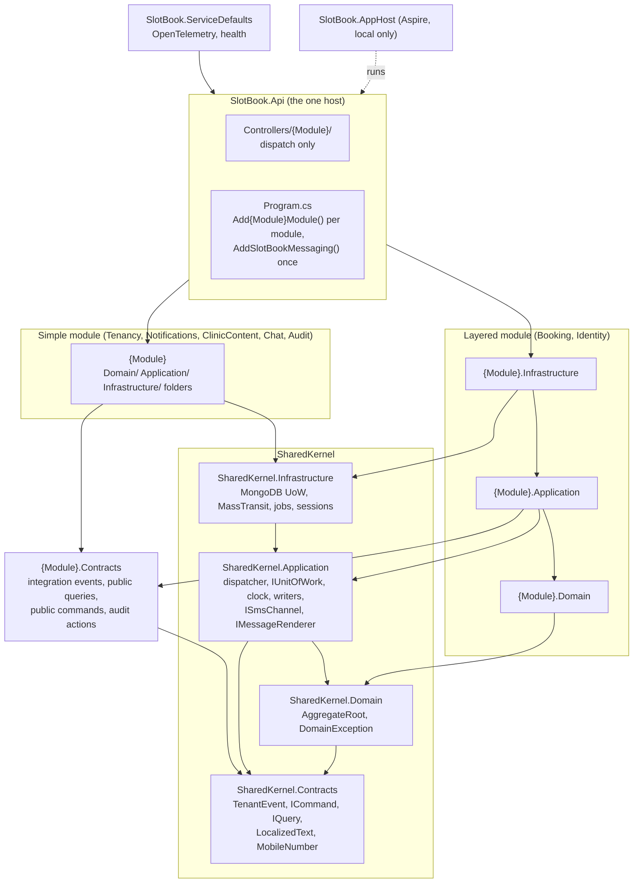
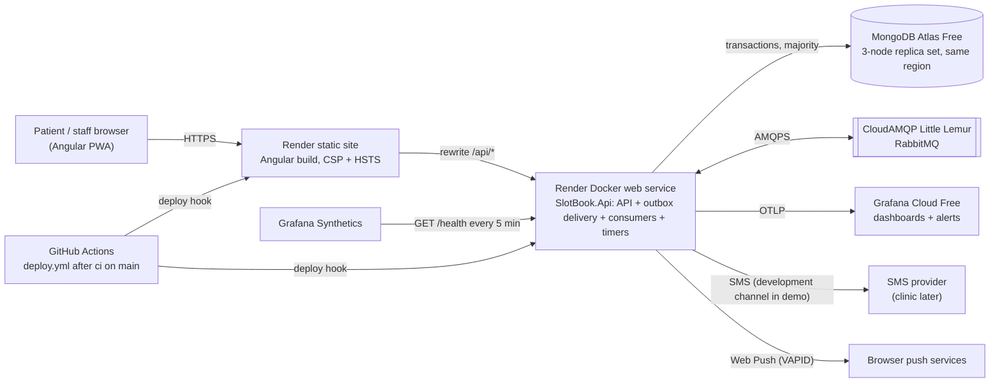
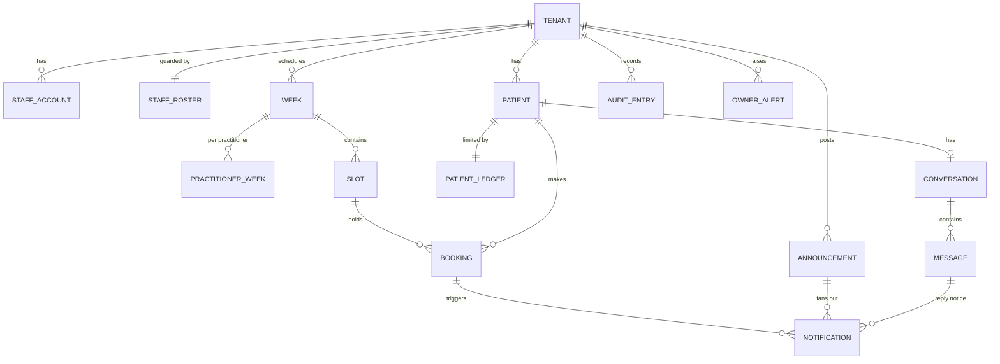
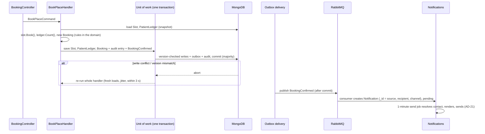

# Architecture Spine — SlotBook

> **The spine wins.** A story that cannot satisfy an AD stops and comments on the
> issue. It never works around the rule.

## Design Paradigm

**A modular monolith.** One .NET process, built from Clean Architecture modules. Each
module is a DDD bounded context with its own aggregates. Modules integrate through
integration events that leave by a transactional outbox. Angular is a separate static
site.

- The structure follows the developer's modular-monolith reference: each module lives
  under `Modules/{Module}/`, there is a four-part shared kernel, and one thin host
  composes the modules.
- **Module isolation is enforced by the compiler.** A module project can reference
  only the shared kernel and other modules' `.Contracts` projects.
- **Layer direction** is enforced by the compiler inside the two layered modules, and
  by fitness tests inside the simple modules.



A module may reference **other** modules' `.Contracts` projects. It never references
their module projects.

| Module | Shape | Owns (aggregates and collections) | Built by |
| --- | --- | --- | --- |
| `Tenancy` | simple | Tenant (global): **every** FR-39 setting, including per-language texts (home warning, privacy notice, chat response time), reason categories (retire-only), languages, booking limits, ticket prefix | epic 2 |
| `Identity` | layered | Patient, StaffAccount (roles, enabled, password, TOTP, recovery codes), StaffRoster (one per tenant), OtpChallenge, KnownDevice (global lookup), Session (global lookup), OtpBudget (one per tenant per local day) | epics 2, 4 |
| `Booking` | layered | Week, PractitionerWeek, Slot, Booking, PatientLedger; staff lists, patient lookup, door check, public ticket check; the lapse, reminders, reconciliation and `codeLive` jobs | epics 3, 5, 7, 8, 9 |
| `Notifications` | simple | Notification, PushSubscription, `dev_outbox`; channels (SMS, push, development); the send job; server-side message templates | epic 6 |
| `ClinicContent` | simple | OfficialContacts, Announcement, FraudReport only (the home warning text is a Tenancy setting) | epics 9, 11 |
| `Chat` | simple | Conversation, Message, CannedReply | epic 12 |
| `Audit` | simple | AuditEntry (append-only), OwnerAlert; implements the shared writers (AD-20) | epic 2 |
| SharedKernel | — | `leases`, `migrations`, `data_protection_keys` (all global); MassTransit's outbox and inbox collections | epic 1 |

## Invariants & Rules

### AD-1 — One deployable: a modular monolith on one free web service

- **Binds:** all epics
- **Prevents:** a story adding a second always-on process, which breaks Render's 750
  free instance-hours a month (two services need about 1,488); modules growing hidden
  runtime dependencies on separate hosting.
- **Rule:** the backend is exactly one .NET process on one Render free web service. It
  hosts the API, the MassTransit outbox delivery and consumers, and all timers as
  hosted services. The frontend is one Render static site. No story adds another
  deployable. Moving a module out is an architecture change, recorded in an ADR.

### AD-2 — Project references and layer direction

- **Binds:** all backend code
- **Prevents:** the domain depending on MongoDB or MassTransit; handlers reaching into
  Infrastructure; broker types leaking out of Infrastructure; Contracts that can't
  compile.
- **Rule:**
  - Direct `ProjectReference`s follow the diagram above and nothing else. Transitive
    references through allowed edges are fine.
  - A `.Contracts` project references only `SharedKernel.Contracts`, which holds
    `TenantEvent`, `ICommand<T>`, `IQuery<T>`, `LocalizedText` and `MobileNumber`.
  - `SharedKernel.Domain`, `SharedKernel.Contracts`, every `{Module}.Domain` and every
    `.Contracts` project reference no MongoDB, MassTransit or ASP.NET package.
  - Fitness tests (ArchUnitNET, AD-19) fail the build if, in any module (including the
    folders of a simple module): Domain code depends on Application or Infrastructure
    code, `MongoDB.*` or `MassTransit`; Application code depends on Infrastructure code,
    `MongoDB.*` or `MassTransit`; Api code depends on `MongoDB.*` or `MassTransit`.

### AD-3 — Module boundaries and data ownership

- **Binds:** all epics; the module table under Design Paradigm
- **Prevents:** two modules owning one entity; one module reading or writing another's
  collections, which blocks later extraction and splits invariants.
- **Rule:**
  - Every aggregate and collection belongs to exactly one module (table above). A
    module writes only its own collections. The only exceptions are audit entries and
    owner alerts, written through the shared writers (AD-20).
  - **Reads across modules:** dispatch a public query declared in the owner's
    `{Module}.Contracts`. A module never touches another module's repositories or
    collections. Queries that serve lists are batch-shaped
    (`GetStaffDisplayNamesQuery(ids[])`).
  - **Writes across modules in one transaction:** the owner exposes a **public command**
    in its `.Contracts`. Its handler runs inside the caller's unit of work (same
    session, same transaction) and is the only code that writes the owner's
    collections. The list is closed; adding one needs the developer's sign-off:
    - `Identity.EnsurePatientCommand(mobileNumber) → patientId`: get-or-create, never
      returns an erased patient.
  - **Reactions across modules:** integration events from the publisher's `.Contracts`
    (AD-10).
  - **Caches:** a *caller* may cache display-name queries in process for 60 s, and
    nothing else. Owner-side caches are listed in their AD: slug and tenant list
    (AD-5), sessions (AD-12), availability (AD-22). `GetTenantSettingsQuery` is never
    cached by a caller; if Tenancy caches it, saving settings evicts it (FR-39).
  - A module never copies another module's **mutable** display data (names, texts) into
    its own documents. Immutable facts (ids, dates) may be copied.
  - **Tenant settings** have one owner, Tenancy, read through
    `Tenancy.Contracts.GetTenantSettingsQuery`. Per-language text everywhere is
    `LocalizedText`, with the FR-39 fallback to the default language applied by one
    shared helper.
  - **Reason categories are retire-only** (developer, 2026-10-10). There is no delete. A
    booking stores `reasonCategoryId`; Booking checks "exists and not retired" through
    the settings query.
  - **Mobile numbers:** `MobileNumber` parses and normalizes every number (digits, the
    tenant's country default). Every module uses its E.164 form. Number → patient id is
    `Identity.Contracts.FindPatientByNumberQuery`.
  - **Patient erasure** (FR-44) is one `PatientErased` event from Identity. Each module
    erases its own data, idempotently. Booking first sets the ledger tombstone (AD-6),
    then cancels each active booking through the normal Cancel use case (actor
    `system`, no notification) and de-identifies it, one transaction per booking.
  - Each module registers itself through one `Add{Module}Module()` in its
    Infrastructure. The host calls one line per module and holds no module logic.

### AD-4 — Aggregates own their state; handlers own mutation

- **Binds:** all modules
- **Prevents:** state transitions scattered across services, controllers or helpers;
  invariants re-checked, or trusted, in several places; refusals that lose their
  effects.
- **Rule:**
  - Every mutable aggregate property has a `private set`. Creating or changing an
    aggregate happens only through a named method on it.
  - Only a command handler loads aggregates through a write repository, calls their
    methods and commits the unit of work. Query handlers read through read repositories
    and never mutate. Controllers dispatch commands and queries and nothing else.
  - Each use case is a folder, `Application/{UseCase}/`, holding the command or query,
    its handler, and a FluentValidation validator. The dispatcher runs the validator
    first; a failure becomes 400.
  - The dispatcher is our own, small, in `SharedKernel.Application`. Handlers and
    validators are registered by assembly scanning. No third-party mediator library.
  - **Aggregates raise no domain events.** The handler stages integration events
    directly through the unit of work (AD-10). There is no in-process notification bus.
  - **Refusals that change nothing** throw `DomainException` (422, or the status AD-13
    gives its code).
  - **Refusals with effects** (an attempt counter, an alert): the aggregate method
    records the effect, the handler commits, then returns `Result.Refused(code)`.
    Proof: 6 parallel wrong OTPs for one challenge leave it invalidated (FR-2).
  - A handler performs no external side effect before commit. SMS and push leave
    through the outbox and the send job (AD-21), so re-running a handler (AD-7) is
    always safe.
  - **The one exception is the OTP SMS** (developer, 2026-10-10). Identity commits the
    challenge with the OTP **hash only**, then sends the plaintext synchronously through
    `ISmsChannel`. The plaintext never reaches MongoDB, the outbox or the broker
    (FR-2), **except** the development channel's `dev_outbox` (AD-17), which
    `Production` refuses (AD-18). The patient's "resend" is the retry. A failed send
    keeps its budget and limit counts and answers 503 `sms_unavailable`.

### AD-5 — Tenant isolation: shared collections, tenant from the session

- **Binds:** all epics; SC-2; NFR-3
- **Prevents:** a handler forgetting a tenant filter; a signed-in request naming another
  tenant; tenant resolution breaking behind the static-site proxy; ad hoc global reads.
- **Rule:**
  - One database. Every tenant-owned document carries `tenantId`. Every unique index on
    a tenant-owned collection begins with `tenantId`.
  - **No API route or query string carries the tenant.**
  - **Signed-in endpoints:** the tenant comes only from the server-side session record
    (AD-12). An `X-Tenant` header, if sent, is ignored.
  - **Anonymous tenant-scoped endpoints** read the tenant slug from the **`X-Tenant`
    header**, carry `[TenantFromHeader]`, and serve only public or self-scoped data.
    Angular sends the header, mapped from its own host name by configuration. Signing in
    binds the new session to that tenant.
  - The current tenant is one ambient `ITenantContext`, set by exactly three entry
    points: the HTTP pipeline (session or `X-Tenant`), the consumer pipeline (from the
    event's `TenantId`), and the job runner (once per tenant, from
    `Tenancy.Contracts.GetActiveTenantIdsQuery`).
  - The repository and unit of work apply the current tenant filter to every read and
    write, and stamp `tenantId` on insert. Handlers never write a tenant filter.
  - **Global collections are exactly:** `tenants`, `sessions`, `known_devices`,
    `leases`, `migrations`, `data_protection_keys`, and MassTransit's outbox and inbox.
    Their aggregates carry `[GlobalAggregate]`.
  - **Global reads are exactly:** slug → tenant id and the active-tenant list (cached
    in process), session by token hash, and known device by secret hash. The last two
    live in `SharedKernel.Infrastructure`'s session store, which returns the `tenantId`
    that the HTTP pipeline then sets. **Global writes** are tenant setup, sessions,
    known devices, leases, migrations and Data Protection keys. Any other global read
    or write needs an ADR.
  - **Tenant setup** is a one-off, idempotent host CLI command
    (`SlotBook.Api seed-tenant`) from configuration: slug, country, IANA zone, week
    start day, the first owner's login name and a one-time password. It creates the
    Tenant, its first owner and its StaffRoster. The owner's first sign-in forces TOTP
    enrolment. No API creates a tenant. Integration tests seed tenant B with the same
    code.
  - **Public tenant profile:** one anonymous `[TenantFromHeader]` endpoint returns the
    display name, IANA time zone, week start day, enabled and default languages,
    publication day and time, home warning, privacy notice, ticket prefix and chat
    response time. Never limits, the OTP budget or other internal settings. Angular
    loads it once at start-up into a `TenantProfile` signal service in `shared/`, and
    every date display reads the zone from there.
  - Fitness tests (AD-19) fail the build if: any action takes a tenant route or query
    parameter; an anonymous tenant-scoped action lacks `[TenantFromHeader]`; a
    signed-in action carries it; code outside `SharedKernel.Infrastructure` constructs
    an unfiltered collection; an aggregate is neither tenant-owned nor
    `[GlobalAggregate]`.
  - The cross-tenant integration suite covers every endpoint.

### AD-6 — One invariant, one guard document

- **Binds:** epics 2, 3, 4, 5, 7, 8, 10; NFR-1; NFR-2; FR-7, FR-10 to FR-25, FR-38
- **Prevents:** write skew under MongoDB snapshot isolation. Two transactions read the
  same state, write different documents, and together break a rule, such as overbooking
  or a breached booking limit.
- **Rule:** every write path that touches an invariant writes that invariant's guard
  document in the same transaction. A conflicting writer then aborts and retries
  (AD-7).

  | Invariant | Guard document | Write paths that must write it |
  | --- | --- | --- |
  | Capacity (free / reserved / taken), sequence numbers (`nextSeq`, never decremented), slot status | Slot | book (patient and practitioner), cancel, reserve, release, change capacity, close, publish |
  | Booking limit: active (confirmed) patient bookings, and patient bookings per week, per patient | PatientLedger (one per tenant + patient) | patient book; **every transition out of `confirmed`** of a counted booking (cancel, check-in, lapse, erasure cancel) |
  | Erasure tombstone | PatientLedger (`erased: true`) | the erasure consumer; **every** booking path (patient and practitioner) loads and writes the ledger and refuses with `not_found` when erased |
  | Booking state (confirmed, checked_in, cancelled, lapsed) | Booking | check-in, cancel, lapse |
  | Daily OTP budget | OtpBudget (one per tenant + local day) | OTP issue |
  | Publication (a week is published at most once) | Week, plus each of its Slots | publish; add a slot to a published week; add or edit a draft slot |
  | No overlapping slots per practitioner (FR-7) | PractitionerWeek (one per tenant + practitioner + week start date) | add slot (draft or published), edit draft slot times, copy last week |
  | At least one enabled owner per tenant (FR-38) | StaffRoster (one per tenant: enabled owner count) | disable, re-enable, add or remove the owner role, create an owner |

  - A booking stores `countsTowardLimit` (true for patient bookings, false for
    practitioner bookings). Every transition method on Booking returns whether the
    ledger must change; the handler loads and saves the ledger in the same transaction.
    The weekly count drops only on cancel (FR-17), never on check-in or lapse.
  - A new invariant gets a guard document, a row here and an ADR-0012 amendment before
    any code is written. A story that discovers a cross-document invariant not in this
    table stops and comments on the issue; it does not invent a guard.

### AD-7 — The write mechanism: unit of work, version check, one transaction, whole-handler retry

- **Binds:** all modules
- **Prevents:** read-then-write races; partial commits; a story inventing its own
  locking or retry; 409 as a booking outcome.
- **Rule:**
  - Every aggregate document carries `version`. The repository saves each changed
    aggregate with `{ _id, tenantId, version }` in the filter, and increments `version`.
  - The unit of work commits every change, every staged integration event (through
    MassTransit's MongoDB outbox on the same session) and every audit entry and alert in
    **one multi-document transaction**, with write concern `majority` and read concern
    `snapshot`.
  - A version mismatch, a write conflict, or an error labelled
    `TransientTransactionError` or `UnknownTransactionCommitResult` **re-runs the whole
    handler** with fresh loads and jittered backoff, within a **time budget of 3 s**
    (not an attempt count), so a hot guard document drains instead of failing.
  - A re-run that finds the refusal condition returns that refusal (`slot_full`).
    Only an exhausted time budget answers 409 `concurrency_conflict`. The NFR-1 suites
    assert zero 409 responses (FR-15, SM-1).
  - A version-checked write of the guard document is how NFR-1's "enforced by the data
    store at commit time" is met. An unguarded read-then-write is the forbidden case.
  - Handlers never call the MongoDB driver or `IMongoCollection` directly.
  - Every row of AD-6 has a concurrency test against a real replica set (NFR-1).
  - **One transaction never spans two instances of one aggregate type,** except:
    publication (Week + its Slots), and copy last week (one PractitionerWeek + its new
    draft Slots, one transaction per practitioner).
  - **Bulk actions** (bulk cancel, close a day) are N independent commands, one
    transaction each, dispatched in sequence by an application service that is not a
    handler. It returns `{ id, outcome: done|refused, code }` per item.

### AD-8 — Uniqueness and dedup by identity

- **Binds:** epics 4, 5, 6, 7, 8, 9, 11, 12; FR-15, FR-22, FR-28, FR-29
- **Prevents:** duplicate SMS on redelivery; ticket-code collisions; one number holding
  two places in one slot; two patients for one number; an idempotency store drifting
  from the real identity.
- **Rule:**
  - Dedup lives on the real documents. There is no separate idempotency collection.
  - **Booking request key (FR-15):** stored on the Booking as `requestKey`, with a
    partial unique index `ux_bookings_tenantId_patientId_requestKey`. A booking command
    first looks up the patient's booking by `requestKey`: same slot → return it (same
    status, same body); different slot → 400 `validation_failed`. A `DuplicateKey` on
    this index re-runs the handler, which then finds the original.
  - **Patient identity:** a partial unique index `ux_patients_tenantId_mobileNumber`
    where `erased: false`. `EnsurePatient` re-runs on `DuplicateKey`.
  - **Notification identity:** `_id` derived from (source key, recipient patient id,
    channel). The source key is (booking id, kind) for booking notifications, the
    announcement id for fan-out, and the message id for chat notices (AD-21).
  - **Ticket code:** `ticketCode` stores exactly the 4 canonical upper-case characters;
    the prefix is never stored, and display uses the tenant's **current** prefix.
    `TicketCode.Parse(input)` in `Booking.Domain` (case, spaces, optional prefix and
    hyphen, Bangla and Arabic-Indic digits) is the only parser, used by the door check
    and the public check. A partial unique index on `(tenantId, ticketCode)` where
    `codeLive: true`; a daily job sets `codeLive: false` once the slot date has passed
    in the tenant's zone. Codes come from a cryptographic RNG; on a duplicate key the
    handler re-runs with a new code.
  - **Same number, same slot:** a partial unique index on `(tenantId, slotId,
    patientId)` where `holdsPlace: true` (every state except `cancelled`).
  - Duplicate-key detection matches the write-error category `DuplicateKey` and the
    expected collection and index, never only the exception type.

### AD-9 — Persistence conventions and schema change

- **Binds:** all modules
- **Prevents:** mixed id types; enum values breaking on reorder; MongoDB attributes in
  the domain; deploys that break during the old/new version overlap or on rollback.
- **Rule:**
  - Use the official `MongoDB.Driver`, with BSON class maps in Infrastructure.
  - Ids are `Guid` version 7 (`Guid.CreateVersion7()` through the clock's
    `TimeProvider`), created in the domain and stored as standard BSON UUID.
    `Guid.NewGuid()` is banned (AD-19).
  - Enums are stored as strings.
  - Every aggregate document has `tenantId` (unless global), `version`, and `createdAt`
    / `updatedAt` in UTC.
  - Collection names are snake_case plural (`slots`, `patient_ledgers`).
  - Indexes are declared in code, one configuration class per aggregate, and created at
    startup.
  - Schema changes are ordered, idempotent C# migrations, run at startup under a lock
    document and recorded in `migrations`. They follow **expand / contract**: add a
    field, backfill, and remove the old one no earlier than the next release. Data fixes
    go through a migration, never by hand.

### AD-10 — Messaging and the outbox

- **Binds:** epics 1, 6, 10, 11, 12, and every module that publishes
- **Prevents:** a message published without its commit, or a commit without its
  message; personal data copied into the broker; MassTransit types spreading through
  the codebase; competing bus registrations.
- **Rule:**
  - MassTransit **8.5.11** (Apache 2.0) over RabbitMQ. MassTransit types appear only in
    Infrastructure.
  - `SharedKernel.Infrastructure` exposes one
    `AddSlotBookMessaging(IConfiguration, params Assembly[] moduleInfrastructureAssemblies)`,
    which the host calls once. It registers every `IConsumer` found in those assemblies.
    Each consumer lives in its module's Infrastructure as a thin adapter that dispatches
    an Application command, and holds no logic.
  - Application stages events through `IUnitOfWork.AddIntegrationEvent`.
    Infrastructure publishes them through MassTransit's **MongoDB bus outbox** on the
    unit of work's session. Consumers use MassTransit's MongoDB inbox.
  - **Every integration event** leaves through the outbox and is consumed through the
    inbox. There is no in-process event dispatch across modules.
  - **Never an integration event:** the booking write itself, audit entries and owner
    alerts (AD-20), and the OTP (AD-4).
  - Events live in the publisher's `{Module}.Contracts`, derive from `TenantEvent
    { Guid EventId; Guid TenantId; DateTimeOffset OccurredAt }`, are past-tense with no
    `Event` suffix (`BookingConfirmed`), and are published and consumed as exactly one
    concrete type.
  - **Event content:** ids, enums, UTC instants and immutable non-personal facts only.
    Never a mobile number, attendee name, age, note, OTP, cancel reason or message
    text. Each event documents its fields in its XML doc; adding a field is additive
    only.
  - Every consumer has an explicit retry definition. Deterministic failures
    (`DomainException`, parse errors) go to the error queue at once. Transient failures
    get a bounded in-memory retry (1 s, 5 s, 15 s, 30 s). There are no broker delayed
    messages. A "not found yet" on a read that the outbox order makes possible is
    transient, never a `DomainException`.
  - `Fault<PatientErased>` is consumed by Audit, which raises `erasure_incomplete`.
  - **Topology:** MassTransit's default publish topology. Receive endpoints are named
    `{module}-{purpose}` in kebab-case. Queues, error queues included, stay under
    CloudAMQP Free's 100.

### AD-11 — Background work: in-process timers with catch-up semantics

- **Binds:** epics 1, 2, 3, 4, 5, 6, 7, 10; FR-8, FR-21, FR-27, FR-29; NFR-2
- **Prevents:** jobs that silently skip work after the service slept or restarted; two
  instances running one job during a deploy overlap; paid schedulers.
- **Rule:**
  - Every timed job is a hosted service in the one process (AD-1), run by the lease-based
    job runner in `SharedKernel.Infrastructure` (built in epic 1). Each run **processes
    everything due up to now** from stored state, never "fire at this exact time". It is
    idempotent, takes a lease document first, runs once per tenant (AD-5), and every
    write follows AD-6 and AD-7.

    | Job | Owner | Period |
    | --- | --- | --- |
    | Scheduled publication | Booking | 30 s |
    | Lapse | Booking | 1 min |
    | Reminders | Booking | 1 min |
    | Notification send and retry (AD-21) | Notifications | 1 min |
    | Count reconciliation of slots **and ledgers**, owner alert on drift (NFR-2) | Booking | daily |
    | `codeLive` clearing | Booking | daily |
    | Retention purge | each module | daily, once Q3 is answered |

  - **Reminders:** the job selects `confirmed` bookings with
    `slotStartsAt − leadTime(now) ≤ now < slotStartsAt` and
    `confirmedAt < slotStartsAt − leadTime`, stages `BookingReminderDue { bookingId }`
    for each, and records `reminderStagedAt` on the Booking. It reads the lead time
    through `GetTenantSettingsQuery` on every run, so a change applies to unsent
    reminders (FR-29).
  - OTP challenges, sessions, known devices and `dev_outbox` entries expire through
    **TTL indexes**, not jobs.
  - The Grafana Synthetics check (AD-18) keeps the service awake.
  - If epic 1's timer proof fails, an external cron calls `/internal/jobs/{job}`; an ADR
    then adds an `internal` authentication scheme (a shared-secret header compared in
    constant time), accepted by the AD-12 fitness test only under `/internal/`. The job
    code stays the same.

### AD-12 — Identity, sessions and audiences

- **Binds:** epics 2, 4, 10, and every endpoint; FR-1 to FR-6, FR-38, FR-44; NFR-4, NFR-5
- **Prevents:** a patient session satisfying a staff endpoint, or the reverse; staff
  accounts without MFA; sessions that can't be revoked; endpoints without an access
  rule; secrets lost on restart.
- **Rule:**
  - **Staff** sign in with a password and a **mandatory TOTP authenticator**, with
    recovery codes, built on ASP.NET Core Identity primitives over our own MongoDB
    store. An owner can reset a practitioner's MFA. Lockout: 5 failures, 15 minutes.
    Password: at least 12 code points, no composition rules.
  - **Patients** sign in with an SMS OTP (FR-1 to FR-3). The OTP request returns the
    same status, body and timing class for known and unknown numbers.
  - **Both audiences use server-side sessions.** A random 256-bit token sits in a
    `Secure; HttpOnly; SameSite=Strict` cookie. Its hash is stored in `sessions` with
    `tenantId`, the subject, the audience, the roles and a TTL. Revoking deletes the
    record. Lifetimes: staff 12 hours absolute, patient 30 days, known-device secret
    90 days (FR-4, stored and handled the same way).
  - Cookie names: `__Host-sb_patient`, `__Host-sb_staff`, `__Host-sb_device`.
  - There are **two authentication schemes, `patient` and `staff`.** Every controller
    action declares **exactly one** scheme, plus roles for staff, or is explicitly
    `[AllowAnonymous]`. A fitness test enumerates every action.
  - **Patient endpoints take the patient only from the session** and never accept a
    patient id; another patient's resource returns 404 (FR-5). Practitioner-scoped
    queries take the practitioner id from the session, never from the request.
  - **Visibility and masking are applied by the owning module** inside its queries and
    endpoints, given the viewer: FR-16's reason and note visibility, and NFR-9 masking.
    The API never returns a full mobile number except on the patient's own endpoints,
    the audited detail view and the owner's CSV export. The cross-patient suite asserts
    this.
  - **Session lookups** are cached in process for at most 30 s. Revoking or disabling
    evicts the entry at once (FR-38's 1 minute).
  - Any change to a staff account's roles or enabled state deletes that account's
    sessions in the same transaction and evicts them.
  - **Fresh OTP:** an action marked `[RequiresFreshOtp]` (Delete my data, FR-44) needs
    an OTP verified for the session's own number within the last 5 minutes, recorded on
    the session. A known-device skip never sets it (FR-4).
  - **CSRF:** Angular's XSRF header is validated by ASP.NET Core antiforgery on every
    unsafe method.
  - **Data Protection keys** persist in the global `data_protection_keys` collection
    through one `IXmlRepository` in `SharedKernel.Infrastructure`, with the application
    name `SlotBook` set explicitly. Epic 1 proves an XSRF token survives a restart.

### AD-13 — API contract and error format

- **Binds:** every endpoint; the Angular client
- **Prevents:** inconsistent error shapes; user-facing text coming from the server;
  breaking changes when the frontend and API deploy at different times.
- **Rule:**
  - Errors are RFC 9457 problem details with a stable snake_case `code` and the
    `traceId`.

    | Status | Meaning |
    | --- | --- |
    | 400 | Validation; body carries `errors: { field: [code] }`, keyed by camelCase field name |
    | 401 | Not signed in |
    | 403 | Wrong audience or role |
    | 404 | Not found (`not_found` is always 404) |
    | 409 | Concurrency time budget exhausted (AD-7) |
    | 422 | Every business refusal, including business limits (`slot_full`, `limit_reached`, `already_booked`, `otp_budget_exhausted`, ...) |
    | 429 | Rate limits only (AD-22), with `Retry-After` |
    | 500 | Unhandled; `code: internal_error` and `traceId` only, never a stack trace or exception text outside `Development` |
    | 503 | A required outside provider is unavailable (`sms_unavailable`), the only 503 |

  - Refusals carry **typed extension members** declared next to their code and present
    in the OpenAPI document: values a message interpolates (`limit`, `free`, `taken`,
    `waitSeconds`), `slot_full` → `suggestedSlotIds[]` with local times, 429 →
    `retryAfterSeconds`.
  - Error codes are defined once, in a `{Module}Errors` class, and are globally unique.
    Shared codes (`not_found`, `validation_failed`, `concurrency_conflict`,
    `rate_limited`, `internal_error`) live in `SharedKernel.Application.CommonErrors`.
    The API never returns user-facing text: Angular maps `errors.{code}` to bn, en and
    ar.
  - **Routes:** controllers in `SlotBook.Api/Controllers/{Module}/` under `/api/...`,
    kebab-case plural nouns, no tenant (AD-5). JSON in camelCase, enums as strings.
  - **Lists** use cursor pagination: `?cursor=&limit=` (default 50, max 200), response
    `{ items, nextCursor }`, sorted by a stable key ending in `_id`.
  - There is **no URL versioning.** API changes are additive; a removal follows
    expand / contract.
  - The OpenAPI document is generated at build into
    `src/backend/SlotBook.Api/openapi.json` and committed; CI fails when it's stale.
    Angular's API types are generated from it into `shared/api/generated/` (types only,
    used by hand-written `HttpClient` services per feature). Generated files are never
    hand-edited; on a merge conflict the agent regenerates both.

### AD-14 — Time

- **Binds:** all modules and the frontend; FR-8, FR-17, FR-18, FR-29, FR-43
- **Prevents:** local and UTC times mixed at the boundaries: publication, cut-off, week
  limits, lapse and reminders.
- **Rule:**
  - Instants are stored as UTC BSON dates. The tenant stores an IANA time-zone id.
  - **Week identity** is the natural key `(tenantId, weekStartDate)`, where
    `weekStartDate` is the local `yyyy-MM-dd` of the tenant's week start day; unique
    index `ux_weeks_tenantId_weekStartDate`. Creating a week is get-or-create, re-run on
    `DuplicateKey`. Every per-week count is keyed by `weekStartDate`.
  - **Slot shape:** `localDate`, `localStart` and `localEnd` (`HH:mm`) are the source of
    truth. `startsAt` / `endsAt` (UTC) are computed in the domain from the tenant's zone
    at creation and never edited. Copy last week copies the local fields and recomputes
    UTC.
  - All "now / today / a day / this week" logic goes through one clock service on
    `TimeProvider` in `SharedKernel.Application`. `DateTime.Now`, `DateTime.UtcNow`,
    `DateTime.Today`, `DateTimeOffset.Now`, `DateTimeOffset.UtcNow` and
    `TimeProvider.System` outside the composition root are banned by
    BannedApiAnalyzers (AD-19).
  - The API returns instants as ISO 8601 with offset. Staff-entered schedule data comes
    **in** as local date + local time without offset; the server applies the tenant's
    zone. The UI renders in the **tenant's** zone from `TenantProfile` (AD-5), never
    the device's.

### AD-15 — Frontend structure

- **Binds:** every epic with screens
- **Prevents:** patient and staff code tangled together; patient pages bloated by staff
  features; per-story state-management choices.
- **Rule:**
  - **One Angular app**: zoneless, standalone, signals, with signals plus services for
    state and no NgRx.
  - **Two lazy route areas**, the patient area at `/` and staff at `/staff`. Neither
    imports the other; shared UI, `TenantProfile` and generated API types live in
    `shared/`.
  - A bundle budget in `angular.json` caps the patient area's initial load (NFR-12).
  - API calls go to the same origin, only under `/api` (including `/api/health`);
    `proxy.conf.json` proxies `/api`.
  - The **PWA service worker** (`@angular/service-worker`) serves Web Push (FR-27) and
    the offline ticket view. It caches only the ticket response for active bookings;
    sign-out, sign-out everywhere (on next load) and erasure clear it. No other personal
    API response is cached.
  - Every patient page has a Playwright test at 360 px with an axe scan (AD-19,
    NFR-15).

### AD-16 — Languages and right-to-left

- **Binds:** every epic with text; FR-28, FR-43; SC-5
- **Prevents:** hard-coded strings; missing translations reaching production; layouts
  that don't mirror in `ar`.
- **Rule:**
  - Angular strings use Transloco, with JSON per language and keys namespaced by
    feature (`booking.confirm.title`). CI fails on a key missing in bn, en or ar.
  - **Server-generated user text** (SMS, push, the OTP SMS) lives only in Notifications
    as `.resx` per language, rendered by one `IMessageRenderer(kind, language, model)`
    (interface in `SharedKernel.Application`) that formats dates in the tenant's zone
    with ASCII digits. An architecture test fails on a key missing in bn, en or ar.
    Each template states its SMS segment budget.
  - Styles use CSS logical properties only; Stylelint bans `margin-left`,
    `padding-right`, `left:` and similar.
  - Ticket codes, mobile numbers and times are wrapped as left-to-right. Digits display
    as ASCII.

### AD-17 — Observability and logs

- **Binds:** all backend code; NFR-11a, NFR-18; SC-6
- **Prevents:** personal data in logs; untraceable errors; per-story logging styles.
- **Rule:**
  - OpenTelemetry traces, metrics and logs go through `SlotBook.ServiceDefaults`: the
    Aspire dashboard locally, OTLP to Grafana Cloud from the demo environment. The API
    also exports a MongoDB command counter (for the AD-18 alert).
  - The W3C trace id is the correlation id, returned as `traceId`.
  - Logs use source-generated `[LoggerMessage]` methods in a `LoggerExtensions.cs` per
    folder; CA1848 and CA2254 are build warnings (ADR-0007 amendment). EventId ranges:
    SharedKernel and Api 1–999, Tenancy 1000–1999, Identity 2000–2999, Booking
    3000–3999, Notifications 4000–4999, ClinicContent 5000–5999, Chat 6000–6999, Audit
    7000–7999. A fitness test checks uniqueness and range.
  - A log or span attribute never contains a full mobile number (log the patient id, or
    the masked last 3 digits), an age, a reason category, a note, an OTP or a session
    token. MongoDB instrumentation never records command text; HTTP instrumentation
    never records bodies or query strings. The integration suite scans the captured
    logs and spans.
  - `/health` and `/api/health` (liveness) and `/health/ready` (MongoDB gates;
    RabbitMQ is reported but doesn't gate) exist.
  - **The development channel** (FR-27) writes OTPs and notifications only to the
    tenant-owned `dev_outbox` collection (TTL 24 hours), never to logs. Its only reader
    is an owner-only `/staff/dev-outbox` page that exists only when the development
    channel is configured. This is the one exemption from FR-2's hash-only storage,
    FR-6 and this AD's OTP rule; `Production` refuses it (AD-18).

### AD-18 — Environments, configuration, deploy and operations

- **Binds:** epics 1, 10; SC-1, SC-7
- **Prevents:** hand-configured environments that drift; secrets in the repo; silent
  fallbacks for missing configuration; deploys that skip CI; outages nobody hears about.
- **Rule:**
  - **Local:** `SlotBook.AppHost` (Aspire) runs the API, Angular, a MongoDB replica set
    and RabbitMQ.
  - **Demo environment:** a Render static site plus a Docker web service (Render has no
    native .NET runtime), Atlas Free, CloudAMQP Little Lemur and Grafana Cloud Free,
    declared in a Render Blueprint (`render.yaml`). Render and Atlas run in the same
    region, named in `render.yaml`. Production comes later, from the same blueprint.
  - The static site rewrites `/api/*` to the web service, so the browser sees one
    origin (proof and fallback in Epic 1 proofs).
  - **Environments** are `Development`, `Demo` and `Production`
    (`ASPNETCORE_ENVIRONMENT`), set explicitly for every service in `render.yaml`
    (unset means `Production`). `Production` with the development SMS channel fails
    startup (FR-27); `Demo` may use it. An integration test proves it.
  - **Deploy:** Render auto-deploy is off (`autoDeploy: false`). A `deploy.yml` workflow
    runs on `workflow_run` of `ci` succeeding on `main` and calls each service's deploy
    hook (hook URLs are GitHub secrets), filtered by path as in ADR-0006. When both
    sides changed, it deploys the API, waits for `/health/ready` on the new version,
    then deploys the static site. `healthCheckPath: /health/ready`, so a failed deploy
    leaves the previous version running.
  - **Security headers:** the static site's headers in `render.yaml` set HSTS and the
    document CSP (`default-src 'self'`; `style-src 'self' 'unsafe-inline'`, never for
    scripts); Angular's `inlineCritical` is off. The API sends `default-src 'none'`.
  - Options are bound and validated at startup; missing required configuration fails
    startup. Secrets live only in Render environment groups, GitHub secrets, user
    secrets or `*.local.json`.
  - **Alerts** (Grafana alert rules, email to the developer): the Synthetics check on
    `/health` every 5 minutes failing twice in a row; 5xx rate above 1% over 5 minutes;
    MongoDB operations above 70/s over 1 minute (from the API's own counter; Atlas Free
    caps at 100/s and 10 GB in / 10 GB out per rolling 7 days); outbox backlog above
    1,000 or any message in an `_error` queue; CloudAMQP queued messages above 5,000.
  - **Incident path:** alert → developer → Render rollback to the previous deploy.
    Data fixes go through a migration (AD-9).

### AD-19 — Test infrastructure, fitness tests and the supply chain

- **Binds:** every story; the sandbox (`sandbox/run-job.sh`) and CI
- **Prevents:** concurrency and isolation claims proven only against fakes; the sandbox
  agent getting control of Docker or deploys; architecture rules enforced only by
  review.
- **Rule:**
  - Tests use xUnit v3 and Shouldly on MTP (ADR-0006).
  - **Integration tests run against a real MongoDB replica set and a real RabbitMQ.** In
    the sandbox, `run-job.sh` starts them as sidecar containers on a private network.
    In CI, they run as service containers from the same images. Tests read connection
    strings from environment variables and use a unique database per test class.
  - Integration tests create sessions through a test-only session seeder; authorization
    stays real. Outside providers (SMS, Web Push) are faked at the `ISmsChannel` and
    push-sender seams. A test round-trips every integration event type through
    MassTransit serialization; tests wait for the outbox to drain before disposing the
    host.
  - The NFR-1 concurrency suite, the cross-tenant suite (SC-2) and the cross-patient
    suite are integration tests.
  - **Browser tests** (ending ADR-0006's deferral; epic 3 is the first real user flow):
    Playwright with `@axe-core/playwright` under `src/frontend/e2e/`, **in CI only**.
    The sandbox stays browserless; the agent reads results through CI. Camera scanning
    stays a manual check recorded in the PR.
  - **Project layout:** every project folder is named exactly after its project
    (`src/backend/Modules/Booking/SlotBook.Modules.Booking.Domain/`). Test projects:
    `src/backend/tests/SlotBook.Modules.{Module}.Tests/` (unit, folders mirror the use
    cases), `SlotBook.SharedKernel.Tests/`, `SlotBook.IntegrationTests/`,
    `SlotBook.ArchitectureTests/`. Epic 1 folds the existing `SlotBook.Api.Tests` into
    `SlotBook.IntegrationTests`.
  - **Rule enforcement inventory** (runs on every build):

    | Rule | Tool | Where |
    | --- | --- | --- |
    | Project references and layer direction (AD-2, AD-3) | ArchUnitNET + project-reference scan | ArchitectureTests |
    | Aggregate properties have no public setter; no mediator package; controllers depend only on the dispatcher (AD-4) | ArchUnitNET | ArchitectureTests |
    | Public commands match AD-3's list | ArchUnitNET | ArchitectureTests |
    | Tenant routes, `[TenantFromHeader]`, unfiltered collections, `[GlobalAggregate]` (AD-5) | ArchUnitNET + endpoint scan | ArchitectureTests |
    | One scheme or `[AllowAnonymous]` per action (AD-12) | endpoint scan | ArchitectureTests |
    | Error codes globally unique (AD-13) | reflection | ArchitectureTests |
    | Banned time APIs and `Guid.NewGuid()` (AD-9, AD-14) | BannedApiAnalyzers, root `BannedSymbols.txt` | build |
    | `[LoggerMessage]` only (AD-17) | CA1848, CA2254 as warnings | build |
    | EventIds unique and in range (AD-17) | reflection | ArchitectureTests |
    | `.resx` keys complete in bn, en, ar (AD-16) | resource scan | ArchitectureTests |
    | Audit details have no free strings; audit repository exposes insert and find only (AD-20) | ArchUnitNET | ArchitectureTests |
    | Transloco keys complete (AD-16) | script | frontend CI |
    | No `innerHTML` with user text, no `bypassSecurityTrust*` (NFR-7) | angular-eslint `no-restricted-syntax` | frontend CI |
    | Logical CSS properties only (AD-16) | Stylelint | frontend CI |
    | OpenAPI document current (AD-13) | build diff | CI |

  - **Supply chain:** the sandbox has no Docker socket, no deploy hooks, no Render or
    Atlas credentials and no token able to merge. `main` is protected by `protect-main`
    (one approval + `ci-ok`). NuGet versions are central (`Directory.Packages.props`);
    npm installs with `npm ci` from the lockfile.

### AD-20 — Audit entries and owner alerts

- **Binds:** epics 2, 3, 4, 5, 6, 7, 8, 9, 10, 11; FR-24, FR-38, FR-42, FR-45; SC-3, SC-4
- **Prevents:** each epic inventing its own audit shape or action names; alerts with no
  write path or repeated without end; personal data in audit details; refusal floods
  amplifying writes.
- **Rule:**
  - Any module records audit entries and owner alerts through `IAuditWriter.Record(...)`
    and `IOwnerAlertWriter.Raise(kind, dedupKey)` in `SharedKernel.Application`, inside
    its own transaction. Audit implements both. These are the only writes across
    module boundaries (AD-3).
  - **Audit entry:** `{ tenantId, at (UTC), actor { kind: staff|patient|system, id?,
    roles[] }, action, target { type, id }, details }`. `action` is
    `"{module}.{noun}.{verb}"` (`booking.booking.cancelled`), declared as constants in
    `{Module}AuditActions` in `.Contracts`; the audit browse filter lists them by
    reflection. `details` is a typed record per action with ids, enums, numbers and
    instants only. A scheduled publication is audited with the owner who scheduled it
    as actor and `details.trigger = scheduled`.
  - Append-only: the audit repository exposes insert and find only (fitness test). A
    database role adds enforcement if Atlas allows it (Deferred).
  - **Owner alerts:** `OwnerAlertKind` is an enum in `SharedKernel.Application` next to
    the writer; adding a kind is a one-line change there. The alert `_id` is derived
    from `(tenantId, kind, dedupKey)`; a duplicate key means "already raised" (AD-8).
    The writer also logs every alert through one `[LoggerMessage]` (FR-45).

    | Kind | Raised by | Dedup key |
    | --- | --- | --- |
    | `otp_budget_exhausted` | Identity | the tenant's local date |
    | `count_drift` | Booking reconciliation | slot id + local date |
    | `notification_failed` | Notifications send job | notification id |
    | `erasure_incomplete` | Audit (`Fault<PatientErased>`) | patient id |
    | `sms_unavailable` | `ISmsChannel`, in its own unit of work (provider failure or quota refusal) | the tenant's local date |

  - **Refusals decided outside a handler** (401 or 403 on signed-in endpoints, 429 on
    staff and patient partitions) are recorded by `IRefusalRecorder` in `SlotBook.Api`
    through `IAuditWriter` in its own unit of work. It keeps an in-process set of
    (tenant, actor, action, UTC minute) keys and skips the write when the key is
    present, so a flood costs at most one write per actor per minute (FR-24).
    Anonymous refusals are logged and counted as a metric, never audited.

### AD-21 — The notification pipeline

- **Binds:** epics 5, 6, 11, 12; FR-27 to FR-29, FR-33, FR-37; NFR-17
- **Prevents:** duplicate sends; personal data stored with a pending send; fan-out
  bursts delaying confirmations; a lost send with no record.
- **Rule:**
  - A **Notification** holds ids, kind, channel, priority, status, `attempts`,
    `nextAttemptAt` and `claimedAt` only, never a number or rendered text. Priority is
    `high` for booking confirmation and cancellation, `low` for everything else.
  - Consumers only **create** Notifications (status `pending`, `_id` per AD-8), one per
    recipient and channel. The fan-out consumer resolves recipients once through
    `Booking.Contracts.GetPatientsWithActiveBookingsQuery(filter)` and creates the
    records directly in batched transactions, never one outbox message per patient.
    The announcement preview count uses the same query; ClinicContent writes one audit
    entry per announcement notify at confirm, with the recipient count.
  - The **send job** (AD-11) claims due Notifications ordered by priority, then
    `nextAttemptAt`: it marks `sending` with `claimedAt` and commits; resolves contact
    data through `Identity.Contracts.GetPatientContactQuery` and booking details through
    `Booking.Contracts.GetBookingForNotificationQuery`; renders through
    `IMessageRenderer`; sends; then records `sent`, or `pending` with `attempts + 1` and
    a back-off that fits 6 attempts within 30 minutes. After the last attempt: `failed`
    and `notification_failed`. A patient resolved as gone marks it `cancelled` and sends
    nothing.
  - A Notification in `sending` whose `claimedAt` is older than 2 minutes is a crashed
    send: it is marked `failed` with the alert, **never resent** (FR-27, at most once).
  - Two receive endpoints (`notifications-high`, `notifications-low`) keep a fan-out
    burst from delaying the creation of confirmation records. The OTP is not on either
    (AD-4).

### AD-22 — Edge protection: rate limits, client IP, availability cache

- **Binds:** every anonymous endpoint; epics 3, 4, 7, 9, 12; NFR-6, NFR-13; FR-3,
  FR-24, FR-26, FR-32, FR-34
- **Prevents:** one shared IP bucket for every patient; spoofed client IPs; limits that
  reset on restart; stale availability; floods that burn Atlas Free's budget.
- **Rule:**
  - **Client IP:** the API uses ForwardedHeaders trusting only the one hop that epic 1
    proves. Every per-IP limit and log reads one `IClientIp`.
  - The **in-memory limiter** (built-in ASP.NET Core rate limiter; valid only while
    AD-1 holds) partitions by IP, staff account id and patient id only. "Per hour" is a
    sliding window of at least 6 segments. Its refusals are 429 `rate_limited` with
    `Retry-After`. Limits set in an FR follow the FR; the rest are configuration with
    these defaults:

    | Endpoint | Default |
    | --- | --- |
    | Anonymous availability | 60 per minute per IP |
    | Staff sign-in | 10 per 15 minutes per IP |
    | OTP verify | 20 per hour per IP (on top of FR-2's 5 per challenge) |

  - **Every per-number and per-day limit** (FR-3 sends per number, FR-26 checks per
    number, FR-32 reports per day) is counted from stored documents, so a restart
    can't reset it, and answers 429 with its own code and `Retry-After`. "A day" is a
    calendar day in the tenant's zone.
  - The daily **OTP budget is a business limit**: 422 `otp_budget_exhausted`, never 429
    (NFR-6).
  - **Availability cache:** anonymous availability is served from an in-process cache
    per tenant and week. Every command that writes a Slot or Week evicts that entry
    after commit (FR-9, FR-13); a 5-second TTL is only the backstop. A booking
    re-checks every rule at commit.

## Epic 1 proofs

Each proof gates other ADs. If one fails, the fallback applies and the listed ADs
change.

| Proof | Gates | Fallback | ADs that change |
| --- | --- | --- | --- |
| The `/api/*` rewrite passes POST bodies, headers and `Set-Cookie` | AD-12, AD-15, AD-18 | A custom domain, API on a subdomain of the same site (`onrender.com` is a public suffix, so `SameSite=Strict` cookies don't cross two of its subdomains). See Open Questions | AD-15, AD-18 |
| The real client IP arrives through the rewrite in a known header | AD-22 | The custom domain, before epic 4 | AD-22 |
| A timer fires through quiet hours with the Synthetics ping | AD-11 | External cron calling `/internal/jobs/{job}` | AD-11, AD-12 |
| Unit of work and MassTransit's outbox share one MongoDB session and commit together | AD-7, AD-10 | A hand-built outbox on the same session (reference P-5) | AD-10 |
| Multi-document transactions work on Atlas Free | AD-6, AD-7 | A paid tier | AD-18 |
| The deployed app loads with zero CSP violations | AD-18 | Adjust `style-src` only, never `script-src` | AD-18 |
| An XSRF token survives a service restart | AD-12 | — (must pass) | — |
| TLS on every hop and Atlas encryption at rest (NFR-10) | AD-18 | — (configuration review) | — |

## Open Questions

| Question | Blocks | Owner |
| --- | --- | --- |
| Custom-domain fallback: does the developer own a domain, or is a ~$10/year domain an accepted exception to NFR-16 ($0)? | Only if a rewrite proof fails | Developer, before epic 1 ends |

## Consistency Conventions

| Concern | Convention |
| --- | --- |
| Project names | `SlotBook.Modules.{Module}` (simple), `SlotBook.Modules.{Module}.Domain` / `.Application` / `.Infrastructure` (layered), `SlotBook.Modules.{Module}.Contracts`, `SlotBook.SharedKernel.Domain` / `.Application` / `.Infrastructure` / `.Contracts`. Folders are named exactly after projects. Namespaces follow the project and folder |
| Module and folder names | PascalCase module names from the module table. Controllers in `SlotBook.Api/Controllers/{Module}/` |
| Commands, queries, handlers, validators | `{Verb}{Noun}Command`, `Get{Noun}Query`, `{Name}Handler`, `{Name}Validator`, one use case per folder: `Application/{UseCase}/`. Public queries and commands live in `{Module}.Contracts` |
| Repositories | `I{Aggregate}WriteRepository` (load and save, commands only) and `I{Aggregate}ReadRepository` (projections, queries only), declared next to the aggregate |
| Integration events | Past tense, no suffix, in the publisher's `.Contracts`, derived from `TenantEvent`, ids and non-personal facts only (AD-10) |
| Audit actions | `"{module}.{noun}.{verb}"` constants in `{Module}AuditActions` (AD-20) |
| Receive endpoints | `{module}-{purpose}`, kebab-case (AD-10) |
| Collections and indexes | Collections snake_case plural. Index names `ux_{collection}_{fields}` (unique) and `ix_{collection}_{fields}` |
| Ids and JSON | Guid v7 as a string in JSON. camelCase properties. Enums as strings |
| Dates | UTC instants in ISO 8601 with offset. Local dates `yyyy-MM-dd`. Display in the tenant's zone |
| Errors | Problem details + `code` + `traceId` (AD-13). Translation key `errors.{code}` |
| Lists | Cursor pagination `{ items, nextCursor }` (AD-13) |
| Mobile numbers | `MobileNumber` (AD-3). E.164 in storage. ASCII digits on output. Masked (last 3 digits) everywhere except the patient's own pages, the audited detail view and the owner's CSV export (audited, formula-escaped) (AD-12) |
| Text limits | Counted in code points after NFC. Validated in the application, never by the database |
| Logging | `[LoggerMessage]` only, EventId range per module. No personal data (AD-17) |
| Configuration | Options classes validated at startup. One section per module |
| Cookies | `__Host-sb_patient`, `__Host-sb_staff`, `__Host-sb_device` (AD-12) |

## Stack

Rows with a version were checked against NuGet, npm or the vendor's docs on 2026-10-10
(`reviews/review-tech-currency.md`). Rows marked "at pin time" get their version checked
and pinned in epic 1, or in the first epic that needs them.

| Name | Version |
| --- | --- |
| .NET SDK (ADR-0003) | floor 10.0.100, rollForward latestFeature (current 10.0.401, runtime 10.0.12) |
| ASP.NET Core (controllers, rate limiter, antiforgery, OpenAPI, Data Protection) | 10.0 |
| `Microsoft.Extensions.ApiDescription.Server` (OpenAPI at build) | at pin time |
| MongoDB.Driver | 3.12.0, pinned together with MassTransit.MongoDb |
| MongoDB server (Atlas Free) | 8.0 |
| MassTransit + MassTransit.RabbitMQ + MassTransit.MongoDb | 8.5.11 (v9 is commercial). Stays on 8.5.11 through the demo, even unsupported; revisit at the first sale |
| RabbitMQ (CloudAMQP Little Lemur) | provider-managed 3.x/4.x; confirmed in epic 1 |
| Aspire (AppHost, ServiceDefaults) | 13.6.1. Angular runs through `AddViteApp` with `PORT` (`AddNpmApp` was removed in Aspire 13) |
| OpenTelemetry .NET (via ServiceDefaults) | at pin time |
| xUnit v3 + Shouldly on Microsoft.Testing.Platform (ADR-0006) | as pinned in the repo |
| ArchUnitNET + its xUnit v3 adapter | 0.13.4 (replaces NetArchTest.Rules, last released 2021) |
| `Microsoft.CodeAnalysis.BannedApiAnalyzers` | at pin time |
| FluentValidation | 12.2.0 (Apache 2.0) |
| Angular (ADR-0005, ADR-0006), `@angular/service-worker` | 22.2 |
| TypeScript | 6.0 |
| Vitest | 5.x |
| Transloco (`@jsverse/transloco`) | 8.4.0 |
| angular-eslint + ESLint, Stylelint | at pin time |
| OpenAPI → TypeScript types generator (one, types only) | at pin time |
| Playwright + `@axe-core/playwright` | at pin time (epic 3) |
| Web Push (VAPID) server library; QR generation and camera-scanning libraries | at pin time (epics 6, 5, 7) |
| Render (Docker web service + static site, free) | platform |
| Grafana Cloud (free: OTLP, Synthetics, alerting) | platform |

## Structural Seed

**Deployment and providers**: the demo environment



**Core entities**: names and relationships only



**Booking write path**: AD-6, AD-7 and AD-21 in one picture



**Source tree**: a seed; the code owns the detail

```text
src/backend/
  SlotBook.Api/                                   # the one host: Program.cs, Controllers/{Module}/, Auth/, Errors/, IClientIp, IRefusalRecorder, rate limiter, seed-tenant CLI
  SlotBook.ServiceDefaults/                       # OpenTelemetry, health
  SlotBook.AppHost/                               # Aspire, local only
  SharedKernel/
    SlotBook.SharedKernel.Domain/                 # AggregateRoot, DomainException
    SlotBook.SharedKernel.Contracts/              # TenantEvent, ICommand/IQuery, LocalizedText, MobileNumber
    SlotBook.SharedKernel.Application/            # dispatcher, Result, IUnitOfWork, ITenantContext, clock, CommonErrors,
                                                  # IAuditWriter, IOwnerAlertWriter + OwnerAlertKind, ISmsChannel, IMessageRenderer
    SlotBook.SharedKernel.Infrastructure/         # MongoDB UoW + repository base, session store, Data Protection repository,
                                                  # AddSlotBookMessaging, migrations runner, lease-based job runner
  Modules/
    Booking/                                      # layered
      SlotBook.Modules.Booking.Domain/            # WeekAggregate/, PractitionerWeekAggregate/, SlotAggregate/, BookingAggregate/, PatientLedgerAggregate/, TicketCode
      SlotBook.Modules.Booking.Application/       # {UseCase}/ command|query + handler + validator
      SlotBook.Modules.Booking.Infrastructure/    # repositories, class maps, indexes, jobs, consumers, ServiceCollectionExtensions
      SlotBook.Modules.Booking.Contracts/         # events, public queries, BookingAuditActions
    Identity/                                     # layered, same four projects
    Tenancy/                                      # simple
      SlotBook.Modules.Tenancy/                   # Domain/, Application/, Infrastructure/ folders
      SlotBook.Modules.Tenancy.Contracts/
    Notifications/  ClinicContent/  Chat/  Audit/ # simple, same shape as Tenancy
  tests/
    SlotBook.Modules.{Module}.Tests/              # unit, mirrors use cases
    SlotBook.SharedKernel.Tests/
    SlotBook.IntegrationTests/                    # real replica set + RabbitMQ: concurrency, cross-tenant, cross-patient, API
    SlotBook.ArchitectureTests/                   # the AD-19 inventory
src/frontend/
  src/app/patient/   # lazy area '/'
  src/app/staff/     # lazy area '/staff'
  src/app/shared/    # UI kit, TenantProfile, api/generated/, i18n
  e2e/               # Playwright + axe, CI only
render.yaml          # Render Blueprint: demo environment
.github/workflows/deploy.yml
```

## Capability → Architecture Map

| Capability / Area | Lives in | Governed by |
| --- | --- | --- |
| Platform slice: SharedKernel projects, the host, dispatcher, unit of work + outbox wiring, problem details, ServiceDefaults, Aspire, the lease-based job runner, Data Protection keys, `render.yaml`, `deploy.yml`, sandbox sidecars, the architecture tests, the epic 1 proofs | epic-deploy-platform | AD-1, AD-2, AD-3, AD-5, AD-7, AD-9, AD-10, AD-11, AD-12, AD-13, AD-14, AD-17, AD-18, AD-19, AD-22 |
| Tenant, settings, staff accounts, MFA, audit log, owner alerts, language infrastructure (FR-38, FR-39, FR-42, FR-43, FR-45) | Tenancy, Identity, Audit | AD-3, AD-5, AD-6 (StaffRoster), AD-12, AD-16, AD-20 |
| Draft week, publication, closing, changes to published weeks (FR-7 to FR-11) | Booking (Week, PractitionerWeek, Slot) | AD-6, AD-7, AD-11, AD-14, AD-22 |
| Patient sign-in, known device, session, OTP budget (FR-1 to FR-6) | Identity | AD-4 (OTP send), AD-6, AD-11 (TTL), AD-12, AD-16, AD-22 |
| Booking, limit, cancel, my bookings, ticket code and page (FR-15 to FR-19, FR-21 to FR-23) | Booking | AD-6, AD-7, AD-8, AD-13 |
| Notifications, reminders (FR-27 to FR-29) | Notifications sends; the reminders job is in Booking | AD-4, AD-8, AD-10, AD-11, AD-16, AD-21 |
| Clinic cancels, door check, check-in, lists, lookup (FR-20, FR-24, FR-25, FR-40, FR-41) | Booking | AD-6, AD-7 (bulk), AD-8 (`TicketCode.Parse`), AD-12 (visibility, masking), AD-20, AD-22 |
| Reserved places, practitioner bookings (FR-12 to FR-14) | Booking (Slot); `EnsurePatient` in Identity | AD-3, AD-6, AD-7 |
| Official contacts, home warning, fraud report, public ticket check (FR-26, FR-30 to FR-32) | ClinicContent (contacts, fraud reports); home warning in Tenancy settings; public check in Booking | AD-5 (anonymous, `X-Tenant`, tenant profile), AD-8, AD-22 |
| Launch readiness (accessibility, language completeness) | frontend | AD-15, AD-16, AD-19 |
| Announcements (FR-33) | ClinicContent; fan-out in Notifications | AD-8, AD-20, AD-21; image storage deferred |
| Chat, canned replies, reply notification (FR-34 to FR-37) | Chat | AD-3, AD-10, AD-21; transport deferred |
| Delete my data (FR-44) | Identity, then every module through `PatientErased` | AD-3, AD-6 (tombstone), AD-10, AD-12 (fresh OTP), AD-20 |
| Concurrency suite (NFR-1), reconciliation (NFR-2) | IntegrationTests; Booking job | AD-6, AD-7, AD-11, AD-19 |

## Deferred

| Item | Why it can wait | Revisit when |
| --- | --- | --- |
| SMS provider and its quota (Q1) | The demo uses the development channel; FR-3's default budget of 300 a day stands | The clinic launch is unparked |
| Daily backups and the restore test (NFR-19) | The demo holds no real data | Before the clinic's first real booking |
| Retention period and purge (Q3), uptime and out-of-hours response (Q5) | Answered with the clinic | Before epic 10 finishes |
| Production environment | Same blueprint as the demo (AD-18) | The clinic launch is unparked |
| Chat transport | Fast-follow; the default is polling at about 125 chats a day | Epic 12 inception |
| Booking path as a single conditional update | Only if the epic 5 load test misses NFR-13 under Atlas Free's 100 ops/s; the AD-6 table stays | The epic 5 load test |
| Append-only audit enforced by a database role | Atlas Free doesn't support `createRole` from a client; a collection-scoped role must come from the Atlas API, if Free allows it. AD-20's repository rule holds meanwhile. If Free can't, record a PRD change (FR-42): database enforcement before the clinic launch | Epic 2 |
| Announcement image storage (≤ 1 MB, JPEG/PNG/WebP) | Epic 11 is fast-follow; it needs a $0 choice (SC-7). Default candidate: MongoDB GridFS, tenant-filtered, server-side decode and re-encode (strips metadata, enforces 1 MB and type), served with `nosniff`; plus a threat-model row | Epic 11 inception |
| Passkeys for staff, Kafka event log, Azure hosting, a distributed cache, live availability updates | Declined or parked by the developer; none is needed by v1 | The developer asks |
| Where the pipeline's worker and dashboard live | Not product architecture; the default is `sandbox/` in this repo | Pipeline work is scheduled |
