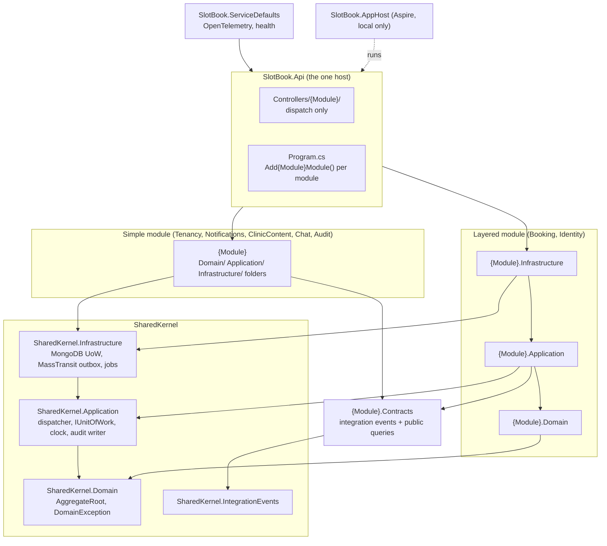
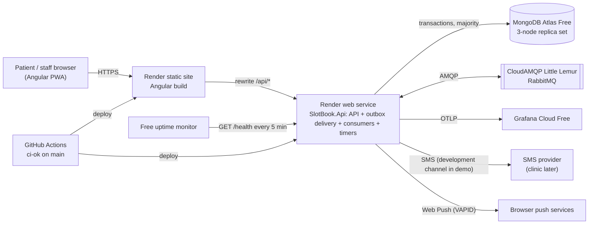
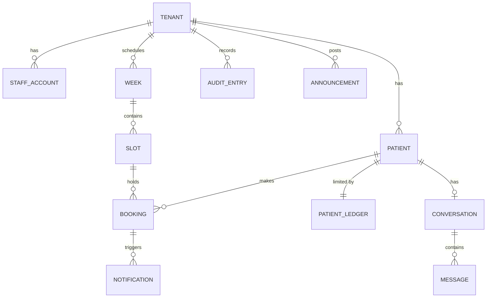
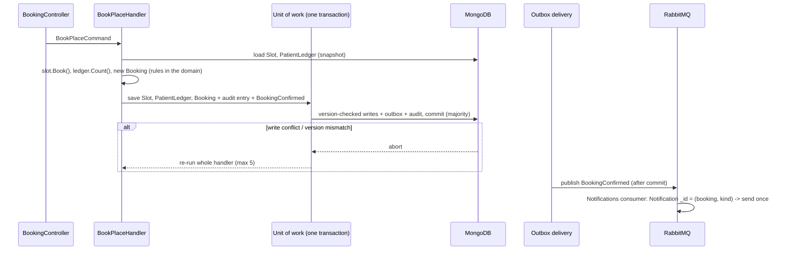

# Architecture Spine — SlotBook

## Design Paradigm

**A modular monolith.** One .NET process, built from Clean Architecture modules. Each
module is a DDD bounded context with its own aggregates. Modules integrate through
integration events that leave by a transactional outbox. Angular is a separate static
site.

- The structure follows the developer's modular-monolith reference: each module lives
  under `Modules/{Module}/`, there is a four-part shared kernel, and one thin host
  composes the modules.
- **Module isolation is enforced by the compiler.** A module project can reference
  only the shared kernel and other modules' `.Contracts` projects.
- **Layer direction** is enforced by the compiler inside the two layered modules, and
  by fitness tests inside the simple modules.



A module may reference **other** modules' `.Contracts` projects. It never references
their module projects.

| Module | Shape | Owns (aggregates) | Built by |
| --- | --- | --- | --- |
| `Tenancy` | simple | Tenant (settings FR-39, reason categories, languages, booking-limit settings) | epic 2 |
| `Identity` | layered | Patient, StaffAccount (roles, active, password, TOTP, recovery codes), OtpChallenge, KnownDevice, Session, OtpBudget (per tenant per local day) | epics 2, 4 |
| `Booking` | layered | Week, Slot, Booking, PatientLedger; staff lists, patient lookup, door check, public ticket check | epics 3, 5, 7, 8, 9 |
| `Notifications` | simple | Notification, PushSubscription, notification channels (SMS, push, development) | epic 6 |
| `ClinicContent` | simple | OfficialContacts, Announcement, FraudReport | epics 9, 11 |
| `Chat` | simple | Conversation, Message, CannedReply | epic 12 |
| `Audit` | simple | AuditEntry (append-only), OwnerAlert | epic 2 |

## Invariants & Rules

### AD-1 — One deployable: a modular monolith on one free web service [ADOPTED]

- **Binds:** all epics
- **Prevents:** a story adding a second always-on process, which breaks Render's 750
  free instance-hours a month (two services need about 1,488); modules growing hidden
  runtime dependencies on separate hosting.
- **Rule:** the backend is exactly one .NET process on one Render free web service. It
  hosts the API, the MassTransit outbox delivery and consumers, and all timers as
  hosted services. The frontend is one Render static site. No story adds another
  deployable. Moving a module out is an architecture change, recorded in an ADR.

### AD-2 — Layer dependency direction

- **Binds:** all backend code
- **Prevents:** the domain depending on MongoDB or MassTransit; handlers reaching into
  Infrastructure; broker types leaking out of Infrastructure.
- **Rule:**
  - Project references follow the diagram above and nothing else.
  - `SharedKernel.Domain`, every `{Module}.Domain` and every `.Contracts` project
    reference no MongoDB, MassTransit or ASP.NET package.
  - Fitness tests (NetArchTest) fail the build if any of these holds, in every module,
    including inside the folders of a simple module:
    - Domain code depends on Application or Infrastructure code, `MongoDB.*` or
      `MassTransit`;
    - Application code depends on Infrastructure code, `MongoDB.*` or `MassTransit`;
    - Api code depends on `MongoDB.*` or `MassTransit`.

### AD-3 — Module boundaries and data ownership

- **Binds:** all epics; the module table under Design Paradigm
- **Prevents:** two modules owning one entity; one module reading or writing another's
  collections, which blocks later extraction and splits invariants.
- **Rule:**
  - Every aggregate belongs to exactly one module (table above). A module writes only
    its own collections. The single exception is audit entries: any module records them
    through the shared audit writer in `SharedKernel.Application`, inside its own
    transaction (AD-10).
  - **Reads across modules:** dispatch a public query declared in the owning module's
    `{Module}.Contracts`. The owner handles it. A module never touches another
    module's repositories or collections.
  - **Reactions across modules:** integration events declared in the publishing
    module's `{Module}.Contracts`. Consumers depend only on that contract.
  - A module project references only `SharedKernel.*` and other modules' `.Contracts`.
    A fitness test reads the project references and fails the build on anything else.
  - Each module registers itself through one `Add{Module}Module()` in its
    Infrastructure. The host calls one line per module and holds no module logic.
  - Patient erasure (FR-44) is one `PatientErased` event from Identity. Each module
    erases its own data, idempotently.

### AD-4 — Aggregates own their state; handlers own mutation

- **Binds:** all modules
- **Prevents:** state transitions scattered across services, controllers or helpers;
  invariants re-checked, or trusted, in several places.
- **Rule:**
  - Every mutable aggregate property has a `private set`. Creating an aggregate or
    changing its state happens only through a named method on the aggregate. A
    transition from the wrong state throws `DomainException`, which becomes 422.
  - Only a command handler loads aggregates through a write repository, calls their
    methods and commits the unit of work.
  - Query handlers read through read repositories and never mutate.
  - Controllers dispatch commands and queries and nothing else.
  - Each use case is a folder, `Application/{UseCase}/`, holding the command or query,
    its handler, and a FluentValidation validator. The dispatcher runs the validator
    first; a failure becomes 400.
  - The dispatcher is our own, small and in `SharedKernel.Application`. Handlers and
    validators are registered by assembly scanning. No third-party mediator library.
  - A handler performs no external side effect before commit. External effects such as
    SMS and push leave through the outbox only, so re-running a handler (AD-7) is always
    safe.

### AD-5 — Tenant isolation: shared collections, tenant from the session

- **Binds:** all epics; SC-2; NFR-3
- **Prevents:** a handler forgetting a tenant filter; a signed-in request naming another
  tenant; tenant resolution breaking behind the static-site proxy.
- **Rule:**
  - One database. Every tenant-owned document carries `tenantId`.
  - **No API route or query string carries the tenant.**
  - **Signed-in endpoints:** the tenant comes only from the server-side session record
    (AD-12). An `X-Tenant` header, if sent, is ignored.
  - **Anonymous tenant-scoped endpoints** (availability, OTP request and verify, staff
    sign-in, public ticket check, official contacts, announcements) read the tenant slug
    from the **`X-Tenant` header**. Angular sends it, mapped from its own host name by
    configuration. Signing in binds the new session to that tenant.
  - The repository and unit of work apply the request's tenant filter to every read and
    write, and stamp `tenantId` on insert. Handlers never write a tenant filter.
  - Every unique index begins with `tenantId`.
  - Every aggregate is either tenant-owned or carries an explicit `[GlobalAggregate]`
    marker.
  - Fitness tests fail the build if:
    - any action takes a tenant route or query parameter;
    - an anonymous tenant-scoped action lacks `[TenantFromHeader]`;
    - a signed-in action carries `[TenantFromHeader]`.
  - The cross-tenant integration suite covers every endpoint.

### AD-6 — One invariant, one guard document

- **Binds:** epics 3, 5, 7, 8; NFR-1; NFR-2; FR-10 to FR-25
- **Prevents:** write skew under MongoDB snapshot isolation. Two transactions read the
  same state, write different documents, and together break a rule, such as overbooking
  or a breached booking limit.
- **Rule:** every write path that touches an invariant writes that invariant's guard
  document in the same transaction. A conflicting writer then aborts and retries
  (AD-7).

  | Invariant | Guard document | Write paths that must write it |
  | --- | --- | --- |
  | Capacity (free / reserved / taken), sequence numbers (`nextSeq`, never decremented), slot status | Slot | book (patient and practitioner), cancel, reserve, release, change capacity, close, publish |
  | Booking limit: active bookings and patient bookings per week, per number | PatientLedger (one per tenant + patient) | patient book, cancel of a counted booking |
  | Booking state (confirmed, checked_in, cancelled, lapsed) | Booking | check-in, cancel, lapse |
  | Daily OTP budget | OtpBudget (one per tenant + local day) | OTP issue |
  | Publication (a week is published at most once) | Week, plus each of its Slots | publish, add or edit a draft slot |

  A new invariant gets a guard document and a row in this table, in an ADR, before any
  code is written.

### AD-7 — The write mechanism: unit of work, version check, one transaction, whole-handler retry

- **Binds:** all modules
- **Prevents:** read-then-write races; partial commits; a story inventing its own
  locking or retry.
- **Rule:**
  - Every aggregate document carries `version`. The repository saves each changed
    aggregate with `{ _id, tenantId, version }` in the filter, and increments `version`.
  - The unit of work commits every change, every staged integration event (through
    MassTransit's MongoDB outbox on the same session) and every audit entry in **one
    multi-document transaction**, with write concern `majority` and read concern
    `snapshot`.
  - A version mismatch, a write conflict, or an error labelled
    `TransientTransactionError` or `UnknownTransactionCommitResult` **re-runs the whole
    handler**, with fresh loads, up to 5 attempts with jittered backoff. Once the
    retries run out, the API answers 409 `concurrency_conflict`.
  - Handlers never call the MongoDB driver or `IMongoCollection` directly.
  - Every row of AD-6 has a concurrency test against a real replica set (NFR-1's list).

### AD-8 — Uniqueness and dedup by identity

- **Binds:** epics 5, 6, 7; FR-15, FR-22, FR-28, FR-29
- **Prevents:** duplicate SMS on redelivery; ticket-code collisions; one number holding
  two places in one slot; a separate idempotency key drifting from the real identity.
- **Rule:**
  - There is no separate idempotency key. Identity is the dedup token.
  - A Notification's `_id` is derived deterministically from (booking id, notification
    kind) for booking notifications, and from the source event id otherwise. A
    redelivered message collides on `_id`, and the consumer treats that as "already
    done".
  - **Ticket code:** a partial unique index on `(tenantId, ticketCode)` where
    `codeLive: true`. A daily job sets `codeLive: false` for bookings whose slot date
    has passed in the tenant's time zone. Codes come from a cryptographic RNG; on a
    duplicate key the handler re-runs with a new code.
  - **Same number, same slot:** a partial unique index on `(tenantId, slotId,
    patientId)` where `holdsPlace: true` (every state except `cancelled`).
  - Duplicate-key detection matches the write-error category `DuplicateKey` and the
    expected collection and index, never only the exception type.

### AD-9 — Persistence conventions and schema change

- **Binds:** all modules
- **Prevents:** mixed id types; enum values breaking on reorder; MongoDB attributes in
  the domain; deploys that break during the old/new version overlap or on rollback.
- **Rule:**
  - Use the official `MongoDB.Driver`, with BSON class maps in Infrastructure.
  - Ids are `Guid` version 7, created in the domain and stored as standard BSON UUID.
  - Enums are stored as strings.
  - Every aggregate document has `tenantId` (unless global), `version`, and `createdAt`
    / `updatedAt` in UTC.
  - Collection names are snake_case plural (`slots`, `patient_ledgers`).
  - Indexes are declared in code, one configuration class per aggregate, and created at
    startup.
  - Schema changes are ordered, idempotent C# migrations, run at startup under a lock
    document and recorded in `migrations`. They follow **expand / contract**: add a
    field, backfill, and remove the old one no earlier than the next release.

### AD-10 — Messaging and the outbox

- **Binds:** epics 6, 11, 12, and every module that publishes
- **Prevents:** a message published without its commit, or a commit without its
  message; an action committed without its audit entry; double sends; MassTransit types
  spreading through the codebase.
- **Rule:**
  - MassTransit **v8.5.x** (Apache 2.0) over RabbitMQ. MassTransit types appear only in
    Infrastructure.
  - Application stages events through `IUnitOfWork.AddIntegrationEvent`.
    Infrastructure publishes them through MassTransit's **MongoDB bus outbox** on the
    unit of work's session. Consumers use MassTransit's MongoDB inbox.
  - **Over the broker:** retryable side effects only, meaning notification sends and
    announcement fan-out.
  - **Never over the broker:** the booking write itself, and **audit entries**, which
    are written in the acting transaction.
  - Integration events live in the publisher's `{Module}.Contracts`. They are
    past-tense, with no `Event` or `IntegrationEvent` suffix (`BookingConfirmed`). Each
    event is published and consumed as exactly one concrete type.
  - Every consumer has an explicit retry definition. Deterministic failures
    (`DomainException`, parse errors) go to the error queue at once. Transient failures
    get a bounded in-memory retry (1 s, 5 s, 15 s, 30 s). There are no broker delayed
    messages.
  - **Notification sends use two priority endpoints**, so a fan-out burst never delays
    a waiting user:
    - **high** (its own queue and concurrency): OTP, booking confirmation and
      cancellation;
    - **low**: reminders, chat-reply notices and announcement fan-out.

### AD-11 — Background work: in-process timers with catch-up semantics

- **Binds:** epics 1, 3, 5, 6, 7, 10; FR-8, FR-21, FR-29; NFR-2
- **Prevents:** jobs that silently skip work after the service slept or restarted; two
  instances running one job during a deploy overlap; paid schedulers.
- **Rule:**
  - Every timed job is a hosted service in the one process (AD-1). Each run **processes
    everything due up to now** from stored state, never "fire at this exact time". It is
    idempotent, and every write follows AD-6 and AD-7.
  - Each job takes a lease document before running.

    | Job | Period |
    | --- | --- |
    | Scheduled publication | 30 s |
    | Lapse | 1 min |
    | Reminders | 1 min |
    | Count reconciliation and owner alert on drift (NFR-2) | daily |
    | `codeLive` clearing | daily |
    | Retention purge | daily, once Q3 is answered |

  - OTP challenges, sessions and known devices expire through **TTL indexes**, not
    jobs.
  - A free external uptime monitor calls `/health` every 5 minutes, which keeps the
    service awake.
  - Epic 1 proves that a timer fires through quiet hours. If it doesn't, an external
    cron calls protected `/internal/jobs/{job}` endpoints, and the job code stays the
    same.

### AD-12 — Identity, sessions and audiences

- **Binds:** epics 2, 4, and every endpoint; FR-1 to FR-6, FR-38, FR-44; NFR-4 to NFR-6
- **Prevents:** a patient session satisfying a staff endpoint, or the reverse; staff
  accounts without MFA; sessions that can't be revoked; endpoints without an access
  rule.
- **Rule:**
  - **Staff** sign in with a password and a **mandatory TOTP authenticator**, with
    recovery codes, built on ASP.NET Core Identity primitives over our own MongoDB
    store. An owner can reset a practitioner's MFA.
  - **Patients** sign in with an SMS OTP. The demo uses the development channel (FR-27).
  - **Both audiences use server-side sessions.** A random 256-bit token sits in a
    `Secure; HttpOnly; SameSite=Strict` cookie. Its hash is stored in `sessions` with
    `tenantId`, the subject, the audience, the roles and a TTL. Revoking a session
    deletes the record.
  - The known-device secret (FR-4) is stored and handled the same way.
  - There are **two authentication schemes, `patient` and `staff`, with separate
    cookies.** Every controller action declares **exactly one** scheme, plus roles for
    staff, or is explicitly `[AllowAnonymous]`. A fitness test enumerates every action.
  - **Patient endpoints take the patient only from the session.** They never accept a
    patient id. Asking for another patient's resource returns 404 (FR-5). A
    cross-patient integration suite runs alongside the cross-tenant one.
  - **Session lookups** are cached in process for at most 30 s. Revoking or disabling
    evicts the entry at once, so FR-38's "within 1 minute" holds without a database read
    on every request.
  - **CSRF:** Angular's XSRF header is validated by ASP.NET Core antiforgery on every
    unsafe method.
  - **Rate limits** (NFR-6) use the built-in ASP.NET Core rate limiter, in memory, per IP
    and per number. That is valid only while AD-1 holds.
  - Anonymous availability reads are served from a 5-second in-process cache per tenant
    and week. That protects the Atlas Free operation budget and NFR-13; a booking
    re-checks every rule at commit.
  - **Security headers:** HSTS, and a CSP of `default-src 'self'`. Angular code never
    calls `bypassSecurityTrust*` or binds user text to `innerHTML` (NFR-7); a lint rule
    enforces this.

### AD-13 — API contract and error format

- **Binds:** every endpoint; the Angular client
- **Prevents:** inconsistent error shapes; user-facing text coming from the server;
  breaking changes when the frontend and API deploy at different times.
- **Rule:**
  - Errors are RFC 9457 problem details. The body carries a stable snake_case `code`
    and the `traceId`.

    | Status | Meaning |
    | --- | --- |
    | 400 | Validation |
    | 401 | Not signed in |
    | 403 | Wrong audience or role |
    | 404 | Not found |
    | 409 | Concurrency retries exhausted |
    | 422 | Every business refusal (`slot_full`, `limit_reached`, `already_booked`, `otp_budget_exhausted`, ...) |
    | 429 | Rate limits only (NFR-6) |

  - Error codes are defined once, in a `{Module}Errors` class. The API never returns
    user-facing text: Angular maps `errors.{code}` to bn, en and ar.
  - **Routes:** controllers in `SlotBook.Api/Controllers/{Module}/` under `/api/...`.
    Kebab-case plural nouns. No tenant in any route (AD-5). JSON in camelCase, enums as
    strings.
  - There is **no URL versioning.** API changes are additive, and a removal follows
    expand / contract.
  - The built-in OpenAPI document is generated and committed. CI fails when it's stale.
    Angular's API types are generated from it.

### AD-14 — Time

- **Binds:** all modules and the frontend; FR-8, FR-17, FR-18, FR-29, FR-43
- **Prevents:** local and UTC times mixed at the boundaries: publication, cut-off, week
  limits, lapse and reminders.
- **Rule:**
  - Instants are stored as UTC BSON dates.
  - The tenant stores an IANA time-zone id. A Slot also stores its local date
    (`yyyy-MM-dd`) for day queries.
  - All "now / today / a day / this week" logic goes through one clock service, built
    on `TimeProvider`, in `SharedKernel.Application`. Code never calls `DateTime.Now` or
    `DateTime.UtcNow`; an analyzer or fitness test bans them.
  - The API exchanges ISO 8601 with offset. The UI renders in the **tenant's** time
    zone.

### AD-15 — Frontend structure

- **Binds:** every epic with screens
- **Prevents:** patient and staff code tangled together; patient pages bloated by staff
  features; per-story state-management choices.
- **Rule:**
  - **One Angular app**: zoneless, standalone, signals, with signals plus services for
    state and no NgRx.
  - It has **two lazy route areas**, the patient area at `/` and staff at `/staff`.
    Neither area imports the other, and shared UI lives in `shared/`.
  - A bundle budget in `angular.json` caps the patient area's initial load (NFR-12).
  - The **PWA service worker** serves Web Push (FR-27) and the offline view of the
    ticket.
  - API calls go to the same origin, under `/api`.

### AD-16 — Languages and right-to-left

- **Binds:** every epic with text; FR-43; SC-5
- **Prevents:** hard-coded strings; missing translations reaching production; layouts
  that don't mirror in `ar`.
- **Rule:**
  - Built-in strings use a runtime translation library (Transloco), with JSON per
    language and keys namespaced by feature (`booking.confirm.title`). CI fails on a key
    missing in bn, en or ar.
  - Styles use CSS logical properties only. `margin-left`, `padding-right`, `left:` and
    similar are banned by a stylelint rule.
  - Ticket codes, mobile numbers and times are wrapped as left-to-right. Digits display
    as ASCII.

### AD-17 — Observability and logs

- **Binds:** all backend code; NFR-11a, NFR-18; SC-6
- **Prevents:** personal data in logs; untraceable errors; per-story logging styles.
- **Rule:**
  - OpenTelemetry traces, metrics and logs go through `SlotBook.ServiceDefaults`. They
    show in the Aspire dashboard locally, and go over OTLP to Grafana Cloud from the demo
    environment.
  - The W3C trace id is the correlation id, returned as `traceId`.
  - Logs use source-generated `[LoggerMessage]` methods in a `LoggerExtensions.cs` per
    folder, with an EventId range per module. A fitness test checks EventIds are unique.
  - A log never contains a full mobile number (log the patient id, or the masked last 3
    digits), an age, a reason category, a note, an OTP or a session token. The same
    applies to trace attributes. MongoDB instrumentation never records command text,
    and HTTP instrumentation never records bodies or query strings. The integration
    suite scans the captured logs and spans for these.
  - `/health` (liveness) and `/health/ready` (MongoDB and RabbitMQ) both exist.

### AD-18 — Environments, configuration and deploy

- **Binds:** epics 1, 10; SC-1, SC-7
- **Prevents:** hand-configured environments that drift; secrets in the repo; silent
  fallbacks for missing configuration.
- **Rule:**
  - **Local:** `SlotBook.AppHost` (Aspire) runs the API, Angular, a MongoDB replica set
    and RabbitMQ.
  - **Demo environment:** a Render static site plus a web service, Atlas Free, CloudAMQP
    Little Lemur and Grafana Cloud Free, all declared in a Render Blueprint
    (`render.yaml`). Production comes later, from the same blueprint.
  - The static site rewrites `/api/*` to the web service.
  - Options are bound and validated at startup, and missing required configuration fails
    startup.
  - Secrets live only in Render environment groups, GitHub secrets, user secrets or
    `*.local.json`.
  - A deploy runs only after `ci-ok` passes on `main`.

### AD-19 — Test infrastructure and fitness tests

- **Binds:** every story; the sandbox (`sandbox/run-job.sh`) and CI
- **Prevents:** concurrency and isolation claims proven only against fakes; the sandbox
  agent getting control of Docker; architecture rules enforced only by review.
- **Rule:**
  - Tests use xUnit v3 and Shouldly on MTP (ADR-0006).
  - **Integration tests run against a real MongoDB replica set and a real RabbitMQ.** In
    the sandbox, `run-job.sh` starts them as sidecar containers on a private network,
    and the agent has no Docker socket. In CI, they run as service containers from the
    same images. Tests read connection strings from environment variables and use a
    unique database per test class.
  - The NFR-1 concurrency suite and the cross-tenant suite (SC-2) are integration tests.
  - Test projects stay under `src/backend/tests/` (ADR-0006):
    - one `{Module}.UnitTests` per module, with folders mirroring the use cases;
    - `SharedKernel.UnitTests`;
    - `SlotBook.IntegrationTests`;
    - `SlotBook.ArchitectureTests`, which holds the fitness tests named in AD-2, AD-3,
      AD-5, AD-12, AD-14 and AD-17 and runs on every build.

## Consistency Conventions

| Concern | Convention |
| --- | --- |
| Project names | `SlotBook.Modules.{Module}` (simple), `SlotBook.Modules.{Module}.Domain` / `.Application` / `.Infrastructure` (layered), `SlotBook.Modules.{Module}.Contracts`, `SlotBook.SharedKernel.Domain` / `.Application` / `.Infrastructure` / `.IntegrationEvents`. Namespaces follow the project and folder |
| Module and folder names | PascalCase module names from the module table. Controllers in `SlotBook.Api/Controllers/{Module}/` |
| Commands, queries, handlers, validators | `{Verb}{Noun}Command`, `Get{Noun}Query`, `{Name}Handler`, `{Name}Validator`, one use case per folder: `Application/{UseCase}/`. Public cross-module queries live in `{Module}.Contracts` |
| Repositories | `I{Aggregate}WriteRepository` (load and save, commands only) and `I{Aggregate}ReadRepository` (projections, queries only), declared next to the aggregate |
| Integration events | Past tense, no suffix (`BookingConfirmed`, `PatientErased`), in the publisher's `{Module}.Contracts` |
| Collections and indexes | Collections snake_case plural. Index names `ux_{collection}_{fields}` (unique) and `ix_{collection}_{fields}` |
| Ids and JSON | Guid v7 as a string in JSON. camelCase properties. Enums as strings |
| Dates | UTC instants in ISO 8601 with offset. Local dates `yyyy-MM-dd`. Display always in the tenant's time zone |
| Errors | Problem details + `code` + `traceId` (AD-13). Translation key `errors.{code}` |
| Mobile numbers | E.164 in storage. ASCII digits on output. Masked (last 3 digits) everywhere except the patient's own pages and the patient detail view (NFR-9) |
| Text limits | Counted in code points after NFC. Validated in the application, never by the database |
| Logging | `[LoggerMessage]` only. No personal data (AD-17) |
| Configuration | Options classes validated at startup. One section per module |

## Stack

| Name | Version |
| --- | --- |
| .NET SDK (ADR-0003) | 10.0.100, rollForward latestFeature |
| ASP.NET Core (controllers, rate limiter, antiforgery, OpenAPI) | 10.0 |
| MongoDB.Driver | 3.12.0 |
| MongoDB server (Atlas Free) | 8.0 |
| MassTransit + MassTransit.RabbitMQ + MassTransit.MongoDb | 8.5.x (latest 8.5 patch at pin time; v9 is commercial) |
| RabbitMQ (CloudAMQP Little Lemur) | provider-managed 3.x/4.x; confirmed in epic 1 |
| Aspire (AppHost, ServiceDefaults, JavaScript app hosting) | 13.4 |
| OpenTelemetry .NET (via ServiceDefaults) | 1.x current at pin time |
| xUnit v3 + Shouldly on Microsoft.Testing.Platform (ADR-0006) | as pinned in the repo |
| NetArchTest.Rules | 1.3.x |
| FluentValidation | 12.1.x (Apache 2.0) |
| Angular (ADR-0005, ADR-0006) | 22.2 |
| TypeScript | 6.0 |
| Vitest | 5.x |
| Transloco (`@jsverse/transloco`) | 7.6.1 (Angular 22 peer support checked in epic 2) |
| Render (web service + static site, free) | platform, no version |
| Grafana Cloud (free, OTLP) | platform, no version |

## Structural Seed

**Deployment and providers**: the demo environment



**Core entities**: names and relationships only



**Booking write path**: AD-6 and AD-7 in one picture



**Source tree**: a seed; the code owns the detail

```text
src/backend/
  SlotBook.Api/                       # the one host: Program.cs (Add{Module}Module per module), Controllers/{Module}/, Auth/, Errors/
  SlotBook.ServiceDefaults/           # OpenTelemetry, health
  SlotBook.AppHost/                   # Aspire, local only
  SharedKernel/
    Domain/                           # AggregateRoot, DomainException, Guid v7 ids
    Application/                      # dispatcher, ICommand/IQuery, IUnitOfWork, clock, audit writer
    Infrastructure/                   # MongoDB unit of work + repositories base, MassTransit outbox, migrations runner, job leases, rate limiting
    IntegrationEvents/                # integration event and public query base types
  Modules/
    Booking/                          # layered
      Domain/                         # WeekAggregate/, SlotAggregate/, BookingAggregate/, PatientLedgerAggregate/
      Application/                    # {UseCase}/ command|query + handler + validator
      Infrastructure/                 # repositories, class maps, indexes, jobs, ServiceCollectionExtensions
      Contracts/                      # BookingConfirmed, BookingCancelled, public queries
    Identity/                         # layered, same four projects
    Tenancy/                          # simple
      Tenancy/                        # Domain/, Application/, Infrastructure/ folders
      Contracts/
    Notifications/  ClinicContent/  Chat/  Audit/   # simple, same shape as Tenancy
  tests/
    Modules/{Module}.UnitTests/       # mirrors use cases
    SharedKernel.UnitTests/
    SlotBook.IntegrationTests/        # real replica set + RabbitMQ: concurrency, cross-tenant, API
    SlotBook.ArchitectureTests/       # fitness tests
src/frontend/
  src/app/patient/   # lazy area '/'
  src/app/staff/     # lazy area '/staff'
  src/app/shared/    # UI kit, API types generated from OpenAPI, i18n
render.yaml          # Render Blueprint: demo environment
```

## Capability → Architecture Map

| Capability / Area | Lives in | Governed by |
| --- | --- | --- |
| Platform slice: the SharedKernel projects, the host, dispatcher, unit of work + outbox wiring, problem details, ServiceDefaults, Aspire, `render.yaml`, sandbox sidecars, the architecture tests | epic-deploy-platform | AD-1, AD-2, AD-3, AD-7, AD-9, AD-10, AD-17, AD-18, AD-19 |
| Tenant, settings, staff accounts, MFA, audit log, owner alerts, language infrastructure (FR-38, FR-39, FR-42, FR-43, FR-45) | Tenancy, Identity, Audit | AD-3, AD-5, AD-12, AD-16 |
| Draft week, publication, closing, changes to published weeks (FR-7 to FR-11) | Booking (Week, Slot) | AD-6, AD-7, AD-11, AD-14 |
| Patient sign-in, known device, session, OTP budget (FR-1 to FR-6) | Identity | AD-6, AD-12, AD-11 (TTL) |
| Booking, limit, cancel, my bookings, ticket code and page (FR-15 to FR-19, FR-21 to FR-23) | Booking | AD-6, AD-7, AD-8, AD-13 |
| Notifications, reminders (FR-27 to FR-29) | Notifications | AD-8, AD-10, AD-11 |
| Clinic cancels, door check, check-in, lists, lookup (FR-20, FR-24, FR-25, FR-40, FR-41) | Booking | AD-6, AD-12, AD-17 (masking) |
| Reserved places, practitioner bookings (FR-12 to FR-14) | Booking (Slot) | AD-6, AD-7 |
| Official contacts, home warning, fraud report, public ticket check (FR-26, FR-30 to FR-32) | ClinicContent; public check in Booking | AD-5 (anonymous, `X-Tenant`), AD-12 (rate limits) |
| Launch readiness (accessibility audit, language completeness, production) | frontend; AD-18 blueprint | AD-15, AD-16, AD-18 |
| Announcements (FR-33) | ClinicContent; fan-out in Notifications | AD-10 |
| Chat, canned replies, reply notification (FR-34 to FR-37) | Chat | AD-3, AD-10; transport deferred |
| Delete my data (FR-44) | Identity, then every module through `PatientErased` | AD-3, AD-12 |
| Concurrency suite (NFR-1), reconciliation (NFR-2) | IntegrationTests; Booking job | AD-6, AD-7, AD-11, AD-19 |

## Deferred

| Item | Why it can wait | Revisit when |
| --- | --- | --- |
| SMS provider and free quota (Q1), default daily OTP budget | The demo uses the development channel behind FR-27's channel interface | The clinic launch is unparked |
| Daily backups and the restore test (NFR-19) | The demo holds no real data | Before the clinic's first real booking |
| Retention period and purge (Q3), uptime and out-of-hours response (Q5) | Answered with the clinic | Before epic 10 finishes |
| Production environment | Same blueprint as the demo (AD-18) | The clinic launch is unparked |
| Chat transport | Fast-follow; the default is polling at about 125 chats a day | Epic 12 inception |
| Booking path as a single conditional update | Only if the epic 5 load test misses NFR-13 under Atlas Free's 100 ops/s; the AD-6 table stays | The epic 5 load test |
| MassTransit after v8 support ends | Unsupported v8 still runs; types stay in Infrastructure | End of 2026, or the first sale |
| Append-only audit enforced by a database role | Depends on whether Atlas Free allows a collection-scoped insert+find role; until then the audit repository exposes insert and find only, checked by a fitness test | Epic 2 |
| Passkeys for staff, Kafka event log, Azure hosting, a distributed cache, live availability updates | Declined or parked by the developer; none is needed by v1 | The developer asks |
| Where the pipeline's worker and dashboard live | Not product architecture; the default is `sandbox/` in this repo | Pipeline work is scheduled |
