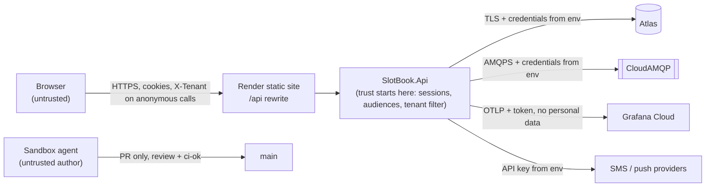

# Threat model — SlotBook

NFR-8 requires a threat model before the security-sensitive epics start: tenant and
staff (2), patient sign-in (4), booking core (5), clinic day (7) and anti-impersonation
(9). It covers the five areas NFR-8 names, plus three that come from the architecture.

- Every mitigation points at the spine decision (`AD-n`) or the PRD rule (`FR-n`,
  `NFR-n`) that carries it. Every threat names the test that proves the mitigation.
- Values the PRD doesn't set (staff lockout, password minimum, staff session length)
  were confirmed by the developer on 2026-10-10.

## What we protect

| Asset | Why it matters |
| --- | --- |
| Patient mobile numbers, attendee names and ages, reason categories, notes | Personal and health-adjacent data (NFR-9, NFR-11a) |
| Bookings and tickets | The fairness of a scarce place, and proof of entry at the door |
| Staff accounts | Practitioners see patient data, and owners control the tenant |
| The SMS budget and the free-tier quotas | Real money once a clinic launches; availability for everyone in the demo |
| Tenant separation | One tenant must never see another's data (NFR-3) |
| The audit log | It must stay trustworthy after the fact (FR-42) |

## Who attacks

- An anonymous internet user, or a script.
- A **bot** grabbing places right after publication.
- A **scammer impersonating the clinic**: fake contacts, fake tickets, asking patients
  for their OTP.
- A **curious patient** probing other patients' data.
- A user of **another tenant**.
- An attacker targeting **staff credentials**.
- A **compromised dependency, or the sandbox agent**, in the delivery pipeline.

## Trust boundaries

## Threats and mitigations

### 1. OTP abuse

| Threat | Mitigation | Proven by |
| --- | --- | --- |
| **SMS pumping.** A script triggers OTPs to many numbers so we pay for the messages | Only the tenant's country is accepted (FR-1). 60 s between resends, at most 5 an hour per number, 100 an hour per IP (FR-3). The **daily OTP budget** is a guard document (AD-6), so it can't be overshot under concurrency. The demo sends through the development channel at no cost | A test of the FR-3 limits. A concurrency test that the budget is never exceeded (AD-6 row) |
| **Brute-forcing a code** | 6 digits, 5 minutes, single use, invalidated after 5 wrong attempts. Stored as a hash and compared in constant time (FR-2) | Tests for each FR-2 consequence |
| **Probing whether a number exists** | The OTP request answers the same way whether or not the number is a known patient | A test comparing the responses for a known and an unknown number |
| **A scammer asks the patient for their code** | The warning on the OTP screen and in the SMS text (FR-6). No staff screen or API ever shows an OTP | An FR-6 test. The log and span scan (AD-17) |
| **Theft of the known-device marker** | A 256-bit random secret, stored as a hash, bound to one number, in a `Secure; HttpOnly; SameSite=Strict` cookie. 90 days. Revoked by signing out or by FR-44 (FR-4, AD-12). XSS controls below | The FR-4 tests: a guessed marker and a marker for another number never match |

### 2. Ticket forgery and enumeration

| Threat | Mitigation | Proven by |
| --- | --- | --- |
| **A forged or edited ticket shown at the door** | The door check is always an online lookup (FR-24). The QR code carries only the code, and the result comes from the database, with the attendee's name and age shown for comparison | The FR-25 forged, reused, wrong-day and cancelled tests |
| **Using one ticket twice** | Check-in is a guarded state transition (AD-6, Booking row) | The double check-in concurrency test (NFR-1) |
| **Guessing codes through the public check** | It needs the code **and** the number. A wrong number answers exactly like an unknown code. 10 checks an hour per IP and 5 per number. Only *Genuine / Cancelled / Not genuine* is ever returned (FR-26) | The FR-26 tests, including that a wrong number gives the same answer as an unknown code |
| **Code collisions or reuse** | A partial unique index while the code is live, and codes from a cryptographic RNG (AD-8) | A uniqueness test across live dates |
| **Enumeration through the staff lookup** | 60 lookups a minute per account, after which 429 and an audit entry (FR-24) | An FR-24 rate-limit test |

### 3. Cross-patient access

| Threat | Mitigation | Proven by |
| --- | --- | --- |
| **IDOR: changing a booking id in a request** | Patient endpoints take the patient only from the session and never accept a patient id. Another patient's resource returns 404, never 403 (FR-5, AD-12). Ids are Guid v7, which are **not** secret, and the design never relies on them being hard to guess | The **cross-patient suite**: two patients in one tenant, every patient endpoint |
| **A practitioner reading outside their role** | Every staff endpoint declares its roles (AD-12, SC-4). Handlers scope "own day" views to the acting practitioner | Role tests per endpoint (SC-4) |

### 4. Cross-tenant access

| Threat | Mitigation | Proven by |
| --- | --- | --- |
| **A tenant A session reading or changing tenant B** | No route carries the tenant. Signed-in calls take it only from the session. The repository applies the tenant filter, and handlers never write one. Unique indexes start with `tenantId` (AD-5) | The **cross-tenant suite** on every endpoint (SC-2). Fitness tests on routes and on the `[TenantFromHeader]` marker |
| **A forged `X-Tenant` header** | It's read only on anonymous endpoints, which serve public or self-scoped data. Signed-in endpoints ignore it (AD-5) | A fitness test plus a cross-tenant test that sends a foreign header with a valid session |

### 5. Staff-account takeover

| Threat | Mitigation | Proven by |
| --- | --- | --- |
| **Password guessing or stuffing** | Lockout after 5 failures for 15 minutes. A per-IP rate limit on sign-in. Passwords of at least 12 characters with no composition rules. **TOTP is mandatory**, so a password alone never signs in (FR-38, AD-12) | A test that a sign-in without the second factor is refused. A lockout test |
| **Session theft** | A server-side session in a `Secure; HttpOnly; SameSite=Strict` cookie. Staff sessions last 12 hours. Disabling an account or revoking a session takes effect within 30 s (AD-12, FR-38) | An FR-38 test: a disabled account's session stops working within 1 minute |
| **CSRF** | `SameSite=Strict` plus the antiforgery header on every unsafe method (AD-12) | A test that a state-changing request without the header is refused |
| **XSS that steals data or acts as the user** | Angular escaping. No `innerHTML` with user text and no `bypassSecurityTrust*` (lint). CSP `default-src 'self'`. User text is never rendered as HTML (NFR-7, AD-12) | The lint rules in CI. A test that stored markup renders as text |
| **Abuse of the MFA reset** | Only an owner can reset a practitioner's MFA. Owners recover through recovery codes or another owner. Every reset is an audit entry (FR-42) | A role test on the reset, and an audit test |

### 6. Bots at publication (fairness)

| Threat | Mitigation | Residual risk |
| --- | --- | --- |
| A script books many places the moment a week opens | Every booking needs a verified number (OTP). The per-number booking limit is a guard document (FR-17, AD-6). Rate limits per IP and per number | Someone with many SIM cards can still book several places. Accepted for v1; practitioners keep reserved places for walk-ins (FR-12) |

### 7. Exhausting free-tier quotas (availability)

| Threat | Mitigation | Residual risk |
| --- | --- | --- |
| Flooding anonymous endpoints to burn Atlas Free's 100 ops/s, CloudAMQP's message quota or Render's hours | Per-IP rate limits (NFR-6). A 5-second cache on availability (AD-12). An in-process session cache, so authenticated requests don't each cost a database read (AD-12) | A distributed flood can still throttle the free tier. Accepted for the demo; a paid tier or an edge cache is the answer at launch |

### 8. Data exposure, and the delivery pipeline

| Threat | Mitigation | Proven by |
| --- | --- | --- |
| Personal data in logs or traces sent to Grafana | No personal data in logs or span attributes. No MongoDB command text, request bodies or query strings in traces (AD-17) | The log and span scan in the integration suite (SC-6) |
| Data intercepted or read at rest | TLS on every hop (Render, Atlas, AMQPS), and Atlas encryption at rest (NFR-10) | Configuration review in epic 1 |
| Masking | Lists, door checks and exports mask numbers; only the owner's CSV export has full numbers, and it's audited (NFR-9) | Masking tests per screen |
| A malicious change slipped in by the sandbox agent or a dependency | The agent works only through PRs: one approval plus `ci-ok` under the `protect-main` ruleset. It has no Docker socket and no deploy secrets (AD-19). Packages are pinned centrally | Branch ruleset (exists). Sandbox configuration (AD-19) |
| Error responses leaking internals | Problem details never include stack traces or personal data outside Development (AD-13) | A test on the shape of a 500 response |

## Open items

- Before the clinic launch: revisit pumping and DoS against a paid SMS provider and a
  production tier (Q1, Q5), and add backup encryption (NFR-19).
